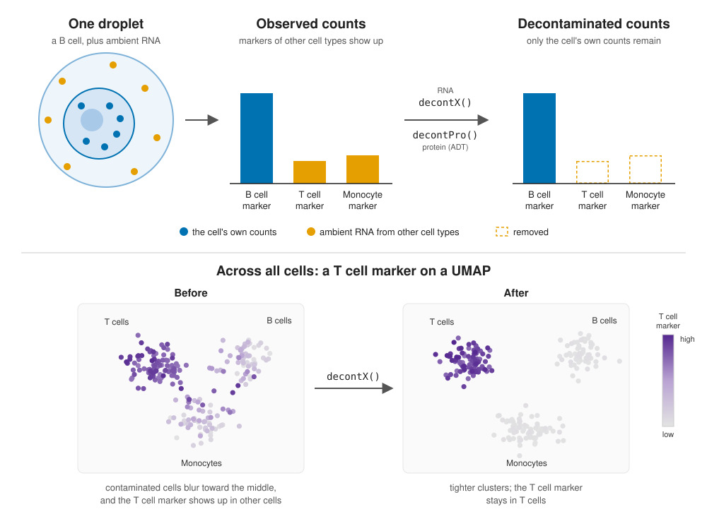

<!-- README.md is generated from README.Rmd. Please edit that file -->

# decontX

<!-- badges: start -->

[](https://github.com/campbio/decontX/actions/workflows/R-CMD-check.yaml)
[](https://codecov.io/gh/campbio/decontX)
[](https://bioconductor.org/checkResults/devel/bioc-LATEST/decontX/)
<!-- badges: end -->

Methods for decontamination of single cell data. This package implements
both DecontX (Yang et al.,
[2020](https://doi.org/10.1186/s13059-020-1950-6)) for single-cell
RNA-seq data and DecontPro (Yin et al.,
[2024](https://doi.org/10.1093/nar/gkad1032)) for single-cell protein
expression data.



## Installation Instructions

You can install the package through
[Bioconductor](https://bioconductor.org/packages/decontX) with:

``` r
if (!require("BiocManager", quietly = TRUE))
    install.packages("BiocManager")

BiocManager::install("decontX")
```

Alternatively, install the development version from the `devel` branch
on [GitHub](https://github.com/campbio/decontX) using the `devtools`
package. Without `ref = "devel"`, `install_github()` installs the current
release instead:

``` r
# install.packages("devtools")
devtools::install_github("campbio/decontX", ref = "devel")
```

## Usage

DecontX takes a count matrix or a SingleCellExperiment with genes in
rows and cells in columns. A minimal example on simulated data:

``` r
library(decontX)

# Simulate a contaminated count matrix with 300 cells
sim <- simulateContamination(seed = 12345)

# Estimate and remove the contamination
result <- decontX(sim$observedCounts)

# The proportion of contamination in each cell, between 0 and 1
head(result$contamination)

# The decontaminated counts
decontaminated <- result$decontXcounts
```

The vignettes show the full workflow, including a SingleCellExperiment,
cluster labels, empty droplets, and plots of the results.

## Documentation

The package website, <https://campbio.github.io/decontX/>, has the
vignettes and the help pages of every function for the current
Bioconductor release. The development version's site is at
<https://campbio.github.io/decontX/dev/>.

## Vignettes

Vignettes are available on
[Bioconductor](https://bioconductor.org/packages/decontX):

- Getting started: an overview of DecontX and DecontPro, with a quick
  example.
- decontX (RNA): the DecontX workflow for single-cell RNA-seq data.
- decontPro (Protein): the DecontPro workflow for CITE-seq ADT data.

To build the vignettes when installing from GitHub, add the flag
`build_vignettes = TRUE`:

``` r
library(devtools)
install_github("campbio/decontX", ref = "devel", build_vignettes = TRUE)
```

Then vignettes can be accessed through:

``` r
vignette('decontX', package = 'decontX')
vignette('decontX_RNA', package = 'decontX')
vignette('decontPro', package = 'decontX')
```

## Citation

Please cite the method you used:

- DecontX, for single-cell RNA-seq: Yang S, Corbett SE, Koga Y, Wang Z,
  Johnson WE, Yajima M, Campbell JD (2020). Decontamination of ambient
  RNA in single-cell RNA-seq with DecontX. *Genome Biology*, 21(1), 57.
  <https://doi.org/10.1186/s13059-020-1950-6>
- DecontPro, for single-cell protein expression data: Yin Y, Yajima M,
  Campbell JD (2024). Characterization and decontamination of background
  noise in droplet-based single-cell protein expression data with
  DecontPro. *Nucleic Acids Research*, 52(1), e4.
  <https://doi.org/10.1093/nar/gkad1032>

In R, `citation("decontX")` prints both references.
