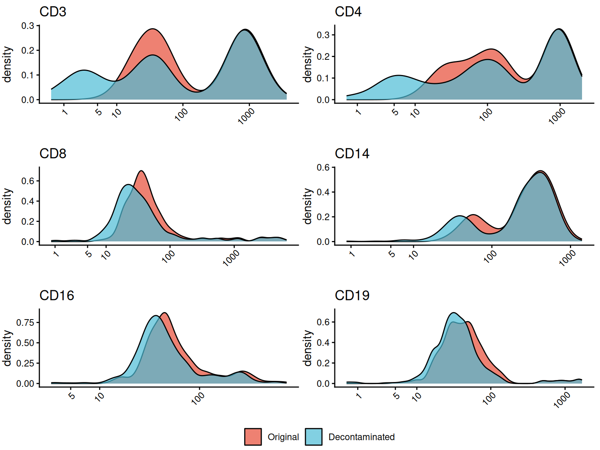
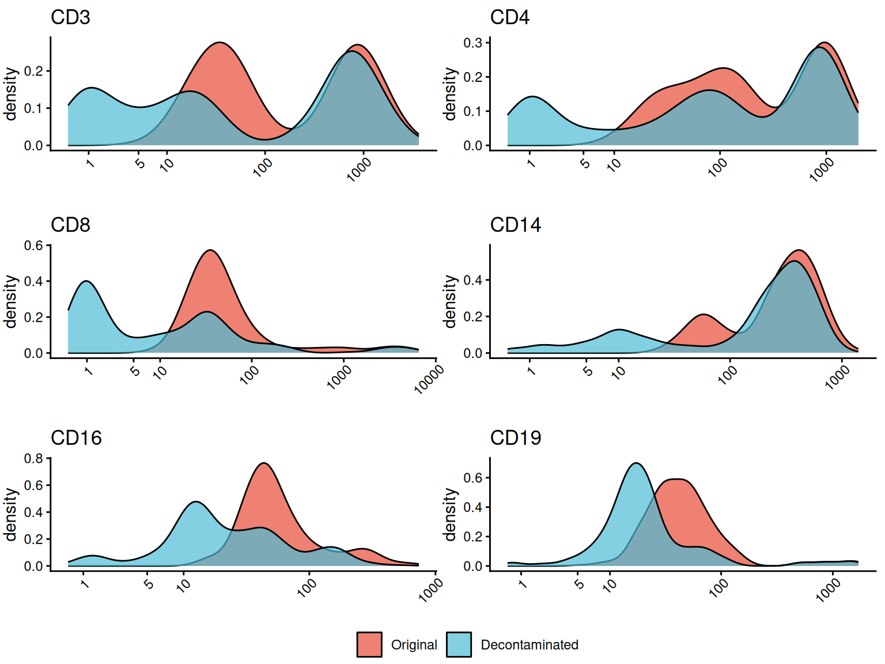
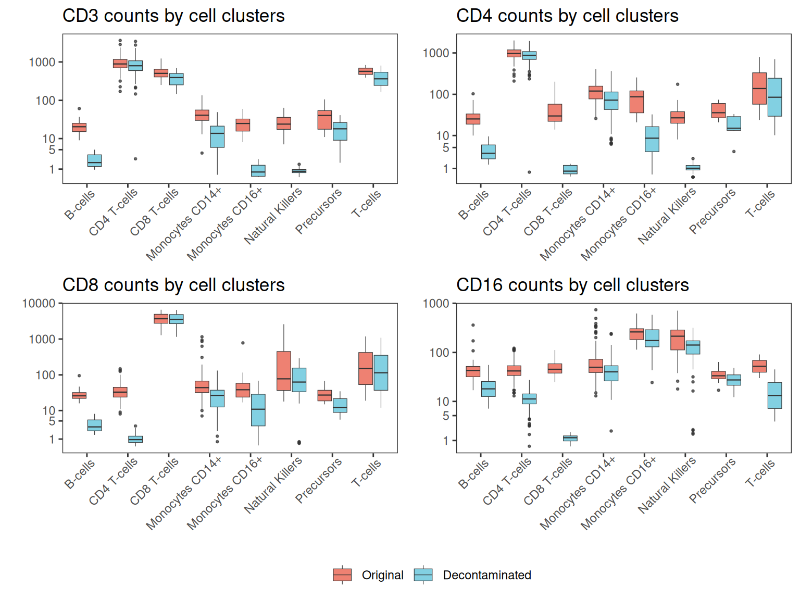

# Decontamination of single cell protein expression data with DecontPro

## Introduction

CITE-seq and similar assays measure proteins on single cells with
antibody-derived tags (ADTs): antibodies carrying a DNA barcode that is
sequenced along with the cell’s RNA. Not every ADT count in a droplet
comes from the proteins on its cell. Two kinds of contamination add
counts:

- **Ambient contamination.** The cell suspension holds ambient material,
  including ADTs, that is captured in droplets along with the cells.
  These ADTs follow the profile of the whole suspension, so they show up
  in cells that don’t express the protein.
- **Background.** Many ADTs show a low, non-specific peak, even in cell
  types that lack the protein. Yin et al. (2024) found this background
  peak to be consistent across cell types, and similar in profile to
  “spongelets”: droplets that cell-calling software calls empty but that
  hold a medium level of ADTs. Its source isn’t known; debris from
  dissociation or dying cells are possible causes.

Left in, contamination blurs the difference between cells that express a
protein and cells that don’t. DecontPro (Yin et al. 2024) is a Bayesian
method that estimates and removes both kinds. It models each ADT count
of a droplet as a mixture of three parts:

- **Native:** ADTs bound to the proteins of the droplet’s cell. Cells of
  the same type share a native profile.
- **Ambient:** one ambient profile, shared by all droplets, estimated
  from the ADT totals of the data or of empty droplets. How much of each
  droplet’s counts comes from it is estimated for each droplet.
- **Background:** a background level for each ADT, which can vary a
  little from droplet to droplet.

DecontPro fits the model with Stan’s variational inference, splits each
count into the three parts in proportion to their estimated rates, and
returns the native part as the decontaminated counts.

For a short overview of the package and of DecontX, its method for RNA
counts, see [Getting started with
decontX](https://campbio.github.io/decontX/dev/articles/decontX.md),
[`vignette("decontX", package = "decontX")`](https://campbio.github.io/decontX/dev/articles/decontX.md).

## Installation

The decontX package, which contains DecontPro, can be installed from
Bioconductor:

\
`if`` ``(``!`[`requireNamespace`](https://rdrr.io/r/base/ns-load.html)`(``"BiocManager"``, quietly ``=`` ``TRUE``)``)`` ``{`\
`    `[`install.packages`](https://rdrr.io/r/utils/install.packages.html)`(``"BiocManager"``)`\
`}`\
`BiocManager``::`[`install`](https://bioconductor.github.io/BiocManager/reference/install.html)`(``"decontX"``)`

Then the package can be loaded in R using the following command:

\
[`library`](https://rdrr.io/r/base/library.html)`(`[`decontX`](https://campbio.github.io/decontX/)`)`

To see the latest updates and releases or to post a bug, see our GitHub
page at <https://github.com/campbio/decontX>.

## Importing data

We use the cord blood CITE-seq data from the SingleCellMultiModal
package. Only the ADT counts and the cell annotations are downloaded
(about 0.3 MB).

\
[`library`](https://rdrr.io/r/base/library.html)`(``SingleCellMultiModal``)`\
\
`# Download the ADT counts and the cell annotations`\
`cordBlood`` ``<-`` `[`CITEseq`](https://rdrr.io/pkg/SingleCellMultiModal/man/CITEseq.html)`(`\
`  ``"cord_blood"``,`\
`  modes ``=`` `[`c`](https://rdrr.io/r/base/c.html)`(``"scADT_Counts"``, ``"coldata_scRNAseq"``)``,`\
`  dry.run ``=`` ``FALSE`\
`)`\
\
`# The ADT count matrix: one row per ADT, one column per droplet`\
`allAdtCounts`` ``<-`` `[`experiments`](https://github.com/waldronlab/MultiAssayExperiment/reference/MultiAssayExperiment-methods.html)`(``cordBlood``)``$``scADT`\
[`dim`](https://rdrr.io/r/base/dim.html)`(``allAdtCounts``)`\
`#> [1]   13 7858`

The matrix holds 13 ADTs and 7,858 droplets. Every droplet is a called
cell, one that cell-calling software such as CellRanger judged to
contain a cell. DecontPro takes this filtered matrix, not the empty
droplets.

## Cell types

DecontPro needs the cell type of each droplet. It learns one native
profile per cell type, so the labels should group cells whose proteins
look alike. The cord blood data come with cell-type labels:

\
`# The cell type of each droplet, in the order of the matrix columns`\
`allCellTypes`` ``<-`` `[`colData`](https://rdrr.io/pkg/SummarizedExperiment/man/SummarizedExperiment-class.html)`(``cordBlood``)``[`[`colnames`](https://rdrr.io/r/base/colnames.html)`(``allAdtCounts``)``, ``"celltype"``]`\
\
`# The number of droplets of each cell type`\
[`table`](https://rdrr.io/r/base/table.html)`(``allCellTypes``, useNA ``=`` ``"ifany"``)`\
`#> allCellTypes`\
`#>         B-cells     CD4 T-cells     CD8 T-cells Monocytes CD14+ Monocytes CD16+ `\
`#>             340            3262             354            2411             143 `\
`#> Natural Killers      Precursors         T-cells            <NA> `\
`#>            1029             115              46             158`

DecontPro needs a label for every droplet. 158 droplets have none, so we
keep the 7,700 labelled ones:

\
`# Find the droplets that have a cell type`\
`hasLabel`` ``<-`` ``!`[`is.na`](https://rdrr.io/r/base/NA.html)`(``allCellTypes``)`\
\
`# Keep their counts and cell types`\
`labelledCounts`` ``<-`` ``allAdtCounts``[``, ``hasLabel``]`\
`labelledCellTypes`` ``<-`` ``allCellTypes``[``hasLabel``]`

To keep this vignette fast, we sample 500 droplets. Don’t subsample your
own data: DecontPro estimates the ambient profile from all the droplets
it is given, so a subsample, especially a biased one, can bias that
estimate.

\
`# Sample 500 droplets at random`\
[`set.seed`](https://rdrr.io/r/base/Random.html)`(``42``)`\
`sampledDroplets`` ``<-`` `[`sample`](https://rdrr.io/r/base/sample.html)`(`[`ncol`](https://rdrr.io/r/base/nrow.html)`(``labelledCounts``)``, ``500``)`\
\
`# The counts and cell types of the sampled droplets`\
`adtCounts`` ``<-`` ``labelledCounts``[``, ``sampledDroplets``]`\
`cellTypes`` ``<-`` ``labelledCellTypes``[``sampledDroplets``]`\
\
`# The number of sampled droplets of each cell type`\
[`table`](https://rdrr.io/r/base/table.html)`(``cellTypes``)`\
`#> cellTypes`\
`#>         B-cells     CD4 T-cells     CD8 T-cells Monocytes CD14+ Monocytes CD16+ `\
`#>              22             207              22             167              12 `\
`#> Natural Killers      Precursors         T-cells `\
`#>              60               8               2`

The labels can be character strings, as here, integers or a factor. With
your own data, cluster labels work too: for example, Seurat’s cluster
identities can be passed as they are, with `Idents(seuratObject)`. Very
fine clusters split a cell type into small groups, each with its own
native profile; broader cell types are often more useful.

## Running DecontPro

DecontPro takes the count matrix and the cell types:

\
`# Decontaminate the counts, without printing Stan's progress`\
`decontResult`` ``<-`` `[`decontPro`](https://campbio.github.io/decontX/dev/reference/decontPro.md)`(``adtCounts``, ``cellTypes``, verbose ``=`` ``FALSE``)`

`verbose = FALSE` hides DecontPro’s messages and Stan’s progress, which
is long. If the fit fails, Stan’s output is shown anyway.

## The output

The result is a list:

\
`# The elements of the result`\
[`names`](https://rdrr.io/r/base/names.html)`(``decontResult``)`\
`#> [1] "parameters"            "decontaminated_counts" "ambient_counts"       `\
`#> [4] "background_counts"`

- `parameters`: the model’s estimates, described below.
- `decontaminated_counts`: the native part, the counts that come from
  the cell’s own proteins.
- `ambient_counts`: the ambient part.
- `background_counts`: the background part.

The three count matrices have one row per ADT and one column per
droplet, with the row and column names of the input. Each count is split
into the three parts, so they add up to the original counts:

\
`# Add the three parts together`\
`summedParts`` ``<-`` ``decontResult``$``decontaminated_counts`` ``+`\
`  ``decontResult``$``ambient_counts`` ``+`\
`  ``decontResult``$``background_counts`\
\
`# Compare the sum with the original counts`\
[`all.equal`](https://rdrr.io/r/base/all.equal.html)`(``summedParts``, ``adtCounts``)`\
`#> [1] TRUE`

The share of all counts that DecontPro called ambient or background:

\
`# Share of all counts called ambient`\
[`sum`](https://rdrr.io/r/base/sum.html)`(``decontResult``$``ambient_counts``)`` ``/`` `[`sum`](https://rdrr.io/r/base/sum.html)`(``adtCounts``)`\
`#> [1] 0.08551285`\
\
`# Share of all counts called background`\
[`sum`](https://rdrr.io/r/base/sum.html)`(``decontResult``$``background_counts``)`` ``/`` `[`sum`](https://rdrr.io/r/base/sum.html)`(``adtCounts``)`\
`#> [1] 0.01165933`

`decontResult$parameters` holds:

- `delta_sd`, `background_sd`: the values of the two priors used in the
  fit.
- `r_est`: the native profile of each cell type, with one row per cell
  type, named by its label, and one column per ADT. Each row sums to 1.
- `p_est`: the ambient profile, the share of each ADT among ambient
  counts. It sums to 1.
- `delta_est`: for each ADT (row) in each droplet (column), the weight
  of the ambient profile in the part of the counts that isn’t
  background; the native profile gets the rest (1 minus this weight).
- `delta_mean_est`: for each droplet, the mean level of `delta_est`.
- `background_est`: for each ADT (row) in each droplet (column), the
  background as a proportion of the droplet’s total count.
- `background_mean_est`: for each ADT, the mean level of
  `background_est`.

The ADTs and droplets of these estimates carry the row and column names
of the counts, so a droplet’s values can be looked up by its barcode.

## Tuning the priors

The density of each ADT before and after decontamination shows whether
the results are reasonable. Many ADTs have two peaks: a low one from
cells that don’t express the protein, whose counts are mostly
contamination, and a high one from cells that do. Decontamination should
move the low peak toward zero and leave the high peak in place.

\
`# Density of six ADTs before and after decontamination`\
[`plotDensity`](https://campbio.github.io/decontX/dev/reference/plotDensity.md)`(`\
`  ``adtCounts``,`\
`  ``decontResult``$``decontaminated_counts``,`\
`  `[`c`](https://rdrr.io/r/base/c.html)`(``"CD3"``, ``"CD4"``, ``"CD8"``, ``"CD14"``, ``"CD16"``, ``"CD19"``)`\
`)`

With the default priors, little is removed here: most of the low CD8
peak stays where it was, and only part of the low CD3 and CD4 peaks
moves toward zero.

A prior is the model’s assumption about a value before it sees the data.
Two priors, each a standard deviation, control how much DecontPro
removes:

- `deltaSd` (default 2e-5): how much the ambient level can vary from one
  ADT to another within a droplet.
- `backgroundSd` (default 2e-6): how much the background level of an ADT
  can vary from one droplet to another.

Larger values let DecontPro assign more of each count to contamination;
smaller values remove less. We tested the defaults on datasets of 5,000
to 10,000 droplets and 10 to 30 ADTs, and the results were reasonable. A
smaller or a more contaminated dataset may need larger priors. Our 500
droplets are a small dataset, so we try priors 5 times the defaults:

\
`# Decontaminate again with priors 5 times the defaults`\
`tunedResult`` ``<-`` `[`decontPro`](https://campbio.github.io/decontX/dev/reference/decontPro.md)`(`\
`  ``adtCounts``,`\
`  ``cellTypes``,`\
`  deltaSd ``=`` ``1e-4``,`\
`  backgroundSd ``=`` ``1e-5``,`\
`  verbose ``=`` ``FALSE`\
`)`

\
`# Density of the same ADTs after the second fit`\
[`plotDensity`](https://campbio.github.io/decontX/dev/reference/plotDensity.md)`(`\
`  ``adtCounts``,`\
`  ``tunedResult``$``decontaminated_counts``,`\
`  `[`c`](https://rdrr.io/r/base/c.html)`(``"CD3"``, ``"CD4"``, ``"CD8"``, ``"CD14"``, ``"CD16"``, ``"CD19"``)`\
`)`

Now most of the low CD8 peak, and more of the low CD3 and CD4 peaks,
move toward zero, while the high peaks stay. These results are close to
what the default priors give on all 7,700 labelled droplets. We fitted
those once, outside this vignette: for these 500 droplets, the counts
decontaminated here and those from the fit on all droplets have a
correlation of 0.99 on a log scale.

CD4 is a useful check: it has three peaks, and the middle one comes from
monocytes, which express some CD4. Only the lowest peak should move
toward zero. The middle peak gets a little lower here but stays in
place. Priors that are too large remove real signal: at 10 times the
defaults, the middle CD4 peak is pushed down toward zero, and the high
CD14 peak of the monocytes shrinks.

The decontaminated counts can also be compared within each cell type:

\
`# Counts of four ADTs in each cell type, before and after decontamination`\
[`plotBoxByCluster`](https://campbio.github.io/decontX/dev/reference/plotBoxByCluster.md)`(`\
`  ``adtCounts``,`\
`  ``tunedResult``$``decontaminated_counts``,`\
`  ``cellTypes``,`\
`  `[`c`](https://rdrr.io/r/base/c.html)`(``"CD3"``, ``"CD4"``, ``"CD8"``, ``"CD16"``)`\
`)`

Each protein should stay high in the cell types that express it and fall
in the others. Here CD3 stays high in the T cells and falls close to
zero in B cells and natural killer cells; CD8 stays high in CD8 T cells
and natural killer cells and falls in B cells and CD4 T cells.

Cell types with only a few droplets in this sample, such as T-cells (2
droplets) and Precursors (8), are estimated poorly: their native
profiles rest on very few droplets, and their results differ the most
from the fit on all droplets. This is another reason to run DecontPro on
all of your droplets.

## With empty droplets

By default, DecontPro estimates the ambient profile from the filtered
matrix. If you have the raw matrix, which holds every droplet barcode,
you can estimate it from the empty droplets instead, with the
`background` argument. Only the total of each ADT across those droplets
is used, so `background` sets the ambient profile and nothing else.

The cord blood data don’t include the raw matrix, so this code is a
template. For data processed with CellRanger, the raw matrix is in the
`"outs/raw_feature_bc_matrix/"` subfolder of each sample directory, and
singleCellTK imports it when the `dataType` argument is set to “raw”.
Replace the path with your own sample directory and `cellTypes` with
your own labels:

\
[`library`](https://rdrr.io/r/base/library.html)`(``singleCellTK``)`\
\
`# Import the filtered matrix (the called cells) and the raw matrix.`\
`# Use the same sample directory for both, so the barcodes match.`\
`sceFiltered`` ``<-`` ``importCellRanger``(`\
`  sampleDirs ``=`` ``"path/to/sample1/"``,`\
`  dataType ``=`` ``"filtered"`\
`)`\
`sceRaw`` ``<-`` ``importCellRanger``(`\
`  sampleDirs ``=`` ``"path/to/sample1/"``,`\
`  dataType ``=`` ``"raw"`\
`)`\
\
`# Keep the ADT rows of each matrix`\
`isAdtFiltered`` ``<-`` `[`rowData`](https://rdrr.io/pkg/SummarizedExperiment/man/SummarizedExperiment-class.html)`(``sceFiltered``)``$``feature_type`` ``==`` ``"Antibody Capture"`\
`adtFiltered`` ``<-`` `[`counts`](https://rdrr.io/pkg/BiocGenerics/man/dge.html)`(``sceFiltered``)``[``isAdtFiltered``, ``]`\
`isAdtRaw`` ``<-`` `[`rowData`](https://rdrr.io/pkg/SummarizedExperiment/man/SummarizedExperiment-class.html)`(``sceRaw``)``$``feature_type`` ``==`` ``"Antibody Capture"`\
`adtRaw`` ``<-`` `[`counts`](https://rdrr.io/pkg/BiocGenerics/man/dge.html)`(``sceRaw``)``[``isAdtRaw``, ``]`\
\
`# Estimate the ambient profile from the empty droplets`\
`emptyDropletResult`` ``<-`` `[`decontPro`](https://campbio.github.io/decontX/dev/reference/decontPro.md)`(`\
`  ``adtFiltered``,`\
`  ``cellTypes``,`\
`  background ``=`` ``adtRaw`\
`)`

Like
[`decontX()`](https://campbio.github.io/decontX/dev/reference/decontX.md),
DecontPro removes the called cells from `background` itself: droplets
whose barcodes (column names) are also in the counts are dropped, so the
raw matrix can be given as it is. If either matrix has no column names,
nothing is removed and DecontPro warns, so give it the empty droplets
only. It also warns when no barcode matches but `background` has many
droplets with as many counts as a typical cell, which happens when the
two matrices name the same barcodes differently, for example with and
without a sample prefix. All of `background` goes into one ambient
profile, and its barcodes are matched across all droplets. With several
samples, the barcodes must be unique across samples, for example with a
sample prefix in both matrices; otherwise a barcode that is a cell in
one sample removes an empty droplet with the same barcode in another.

When both matrices have row names, the ADTs are matched by name: ADTs in
`background` that aren’t in the counts are dropped, and every ADT of the
counts must be in `background`. Without row names, the rows must be in
the same order.

## Runtime and reproducibility

The run time grows with the number of ADTs times the number of droplets.
Each fit in this vignette, 13 ADTs in 500 droplets, takes 5 to 10
seconds on a laptop; a fit on all 7,700 labelled droplets takes about 2
minutes. Stan writes a temporary file during the fit, which DecontPro
deletes when the fit ends.

Stan’s fit is random. DecontPro sets Stan’s seed with the `seed`
argument (default 12345), so the same counts, cell types, priors and
seed give the same results. `iter` (default 50000) is the maximum number
of iterations; the fit usually stops earlier, when it converges.

## Frequently asked questions

### Can I give DecontPro the raw matrix with every droplet?

No. DecontPro models each droplet as a cell of a given type, so the
counts must be the filtered matrix, with the called cells only. The raw
matrix can still help, through the `background` argument, which takes it
as it is (see [With empty droplets](#background)).

## Citing DecontPro

If you use DecontPro in your work, please cite:

Yin Y, Yajima M, Campbell JD (2024). Characterization and
decontamination of background noise in droplet-based single-cell protein
expression data with DecontPro. *Nucleic Acids Research*, 52(1), e4.
[doi:10.1093/nar/gkad1032](https://doi.org/10.1093/nar/gkad1032)

`citation("decontX")` prints this reference and the one for DecontX.

## Session information

\
[`sessionInfo`](https://rdrr.io/r/utils/sessionInfo.html)`(``)`\
`#> R version 4.6.1 (2026-06-24)`\
`#> Platform: x86_64-pc-linux-gnu`\
`#> Running under: Ubuntu 24.04.5 LTS`\
`#> `\
`#> Matrix products: default`\
`#> BLAS:   /usr/lib/x86_64-linux-gnu/openblas-pthread/libblas.so.3 `\
`#> LAPACK: /usr/lib/x86_64-linux-gnu/openblas-pthread/libopenblasp-r0.3.26.so;  LAPACK version 3.12.0`\
`#> `\
`#> locale:`\
`#>  [1] LC_CTYPE=en_US.UTF-8       LC_NUMERIC=C              `\
`#>  [3] LC_TIME=en_US.UTF-8        LC_COLLATE=en_US.UTF-8    `\
`#>  [5] LC_MONETARY=en_US.UTF-8    LC_MESSAGES=en_US.UTF-8   `\
`#>  [7] LC_PAPER=en_US.UTF-8       LC_NAME=C                 `\
`#>  [9] LC_ADDRESS=C               LC_TELEPHONE=C            `\
`#> [11] LC_MEASUREMENT=en_US.UTF-8 LC_IDENTIFICATION=C       `\
`#> `\
`#> time zone: Etc/UTC`\
`#> tzcode source: system (glibc)`\
`#> `\
`#> attached base packages:`\
`#> [1] stats4    stats     graphics  grDevices utils     datasets  methods  `\
`#> [8] base     `\
`#> `\
`#> other attached packages:`\
`#>  [1] SingleCellMultiModal_1.25.3 MultiAssayExperiment_1.39.1`\
`#>  [3] SummarizedExperiment_1.43.0 Biobase_2.73.2             `\
`#>  [5] GenomicRanges_1.65.4        Seqinfo_1.3.2              `\
`#>  [7] IRanges_2.47.5              S4Vectors_0.51.10          `\
`#>  [9] BiocGenerics_0.59.13        generics_0.1.4             `\
`#> [11] MatrixGenerics_1.25.0       matrixStats_1.5.0          `\
`#> [13] decontX_1.11.38             BiocStyle_2.41.0           `\
`#> `\
`#> loaded via a namespace (and not attached):`\
`#>   [1] DBI_1.3.0                   httr2_1.3.0                `\
`#>   [3] gridExtra_2.3.1             inline_0.3.21              `\
`#>   [5] rlang_1.3.0                 magrittr_2.0.5             `\
`#>   [7] otel_0.2.0                  compiler_4.6.1             `\
`#>   [9] RSQLite_3.53.3              loo_2.10.1                 `\
`#>  [11] png_0.1-9                   systemfonts_1.3.2          `\
`#>  [13] vctrs_0.7.3                 combinat_0.0-9             `\
`#>  [15] SpatialExperiment_1.23.0    crayon_1.5.3               `\
`#>  [17] pkgconfig_2.0.3             fastmap_1.2.0              `\
`#>  [19] magick_2.9.1                dbplyr_2.6.0               `\
`#>  [21] XVector_0.53.0              labeling_0.4.3             `\
`#>  [23] rmarkdown_2.32              ragg_1.5.2                 `\
`#>  [25] purrr_1.2.2                 bit_4.6.0                  `\
`#>  [27] xfun_0.62                   cachem_1.1.0               `\
`#>  [29] jsonlite_2.0.0              blob_1.3.0                 `\
`#>  [31] DelayedArray_0.39.8         parallel_4.6.1             `\
`#>  [33] R6_2.6.1                    bslib_0.12.0               `\
`#>  [35] RColorBrewer_1.1-3          StanHeaders_2.39.1         `\
`#>  [37] MCMCprecision_0.4.2         parallelly_1.48.0          `\
`#>  [39] jquerylib_0.1.4             Rcpp_1.1.2                 `\
`#>  [41] bookdown_0.48               rstan_2.32.7               `\
`#>  [43] knitr_1.52                  future.apply_1.21.0        `\
`#>  [45] BiocBaseUtils_1.15.1        Matrix_1.7-6               `\
`#>  [47] tidyselect_1.2.1            abind_1.4-8                `\
`#>  [49] yaml_2.3.12                 codetools_0.2-20           `\
`#>  [51] curl_8.1.0                  listenv_1.1.0              `\
`#>  [53] pkgbuild_1.4.8              lattice_0.23-1             `\
`#>  [55] tibble_3.3.1                withr_3.0.3                `\
`#>  [57] KEGGREST_1.53.6             S7_0.2.2                   `\
`#>  [59] evaluate_1.0.5              future_1.80.0              `\
`#>  [61] desc_1.4.3                  RcppParallel_6.2.1         `\
`#>  [63] BiocFileCache_3.3.3         ExperimentHub_3.3.2        `\
`#>  [65] Biostrings_2.81.9           filelock_1.0.3             `\
`#>  [67] pillar_1.11.1               BiocManager_1.30.27        `\
`#>  [69] sp_2.2-4                    BiocVersion_3.24.0         `\
`#>  [71] ggplot2_4.0.3               rstantools_2.7.1           `\
`#>  [73] scales_1.4.0                globals_0.20.0             `\
`#>  [75] glue_1.8.1                  tools_4.6.1                `\
`#>  [77] AnnotationHub_4.3.3         fs_2.1.0                   `\
`#>  [79] dotCall64_1.2               grid_4.6.1                 `\
`#>  [81] QuickJSR_1.11.0             AnnotationDbi_1.75.2       `\
`#>  [83] SingleCellExperiment_1.35.2 patchwork_1.3.2            `\
`#>  [85] cli_3.6.6                   rappdirs_0.3.4             `\
`#>  [87] textshaping_1.0.5           spam_2.11-4                `\
`#>  [89] S4Arrays_1.13.3             dplyr_1.2.1                `\
`#>  [91] gtable_0.3.6                sass_0.4.10                `\
`#>  [93] digest_0.6.39               progressr_1.1.0            `\
`#>  [95] SparseArray_1.13.5          rjson_0.2.23               `\
`#>  [97] htmlwidgets_1.6.4           SeuratObject_5.4.0         `\
`#>  [99] farver_2.1.2                memoise_2.0.1              `\
`#> [101] htmltools_0.5.9             pkgdown_2.2.1              `\
`#> [103] lifecycle_1.0.5             httr_1.4.9                 `\
`#> [105] bit64_4.8.6`
