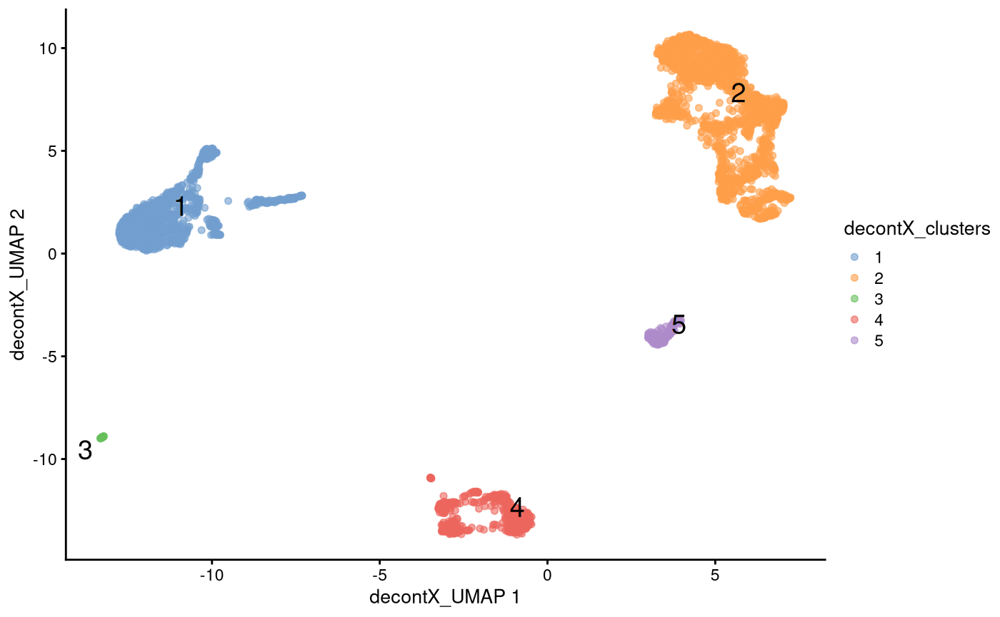
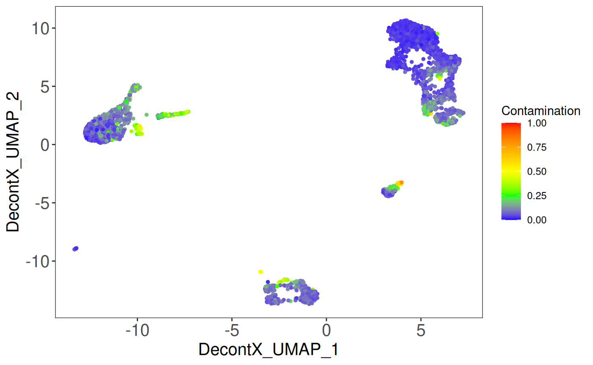
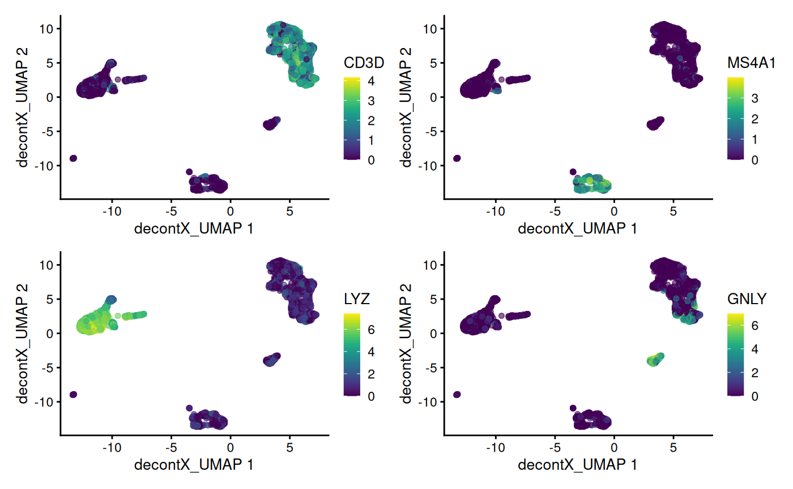
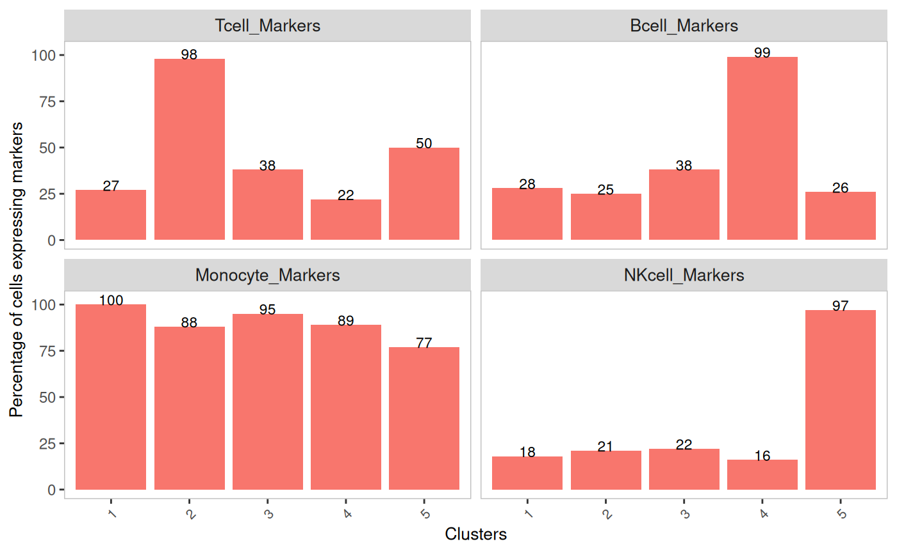
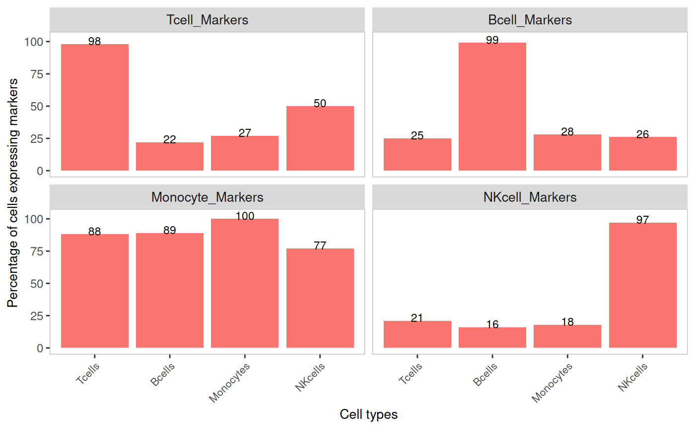
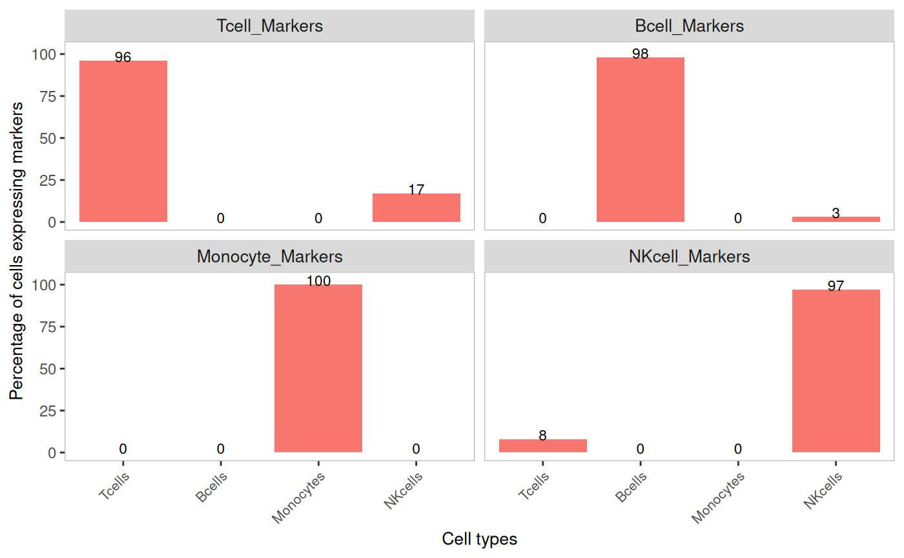
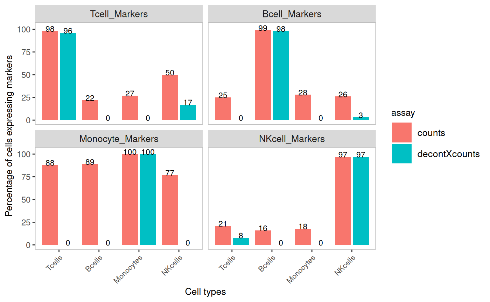
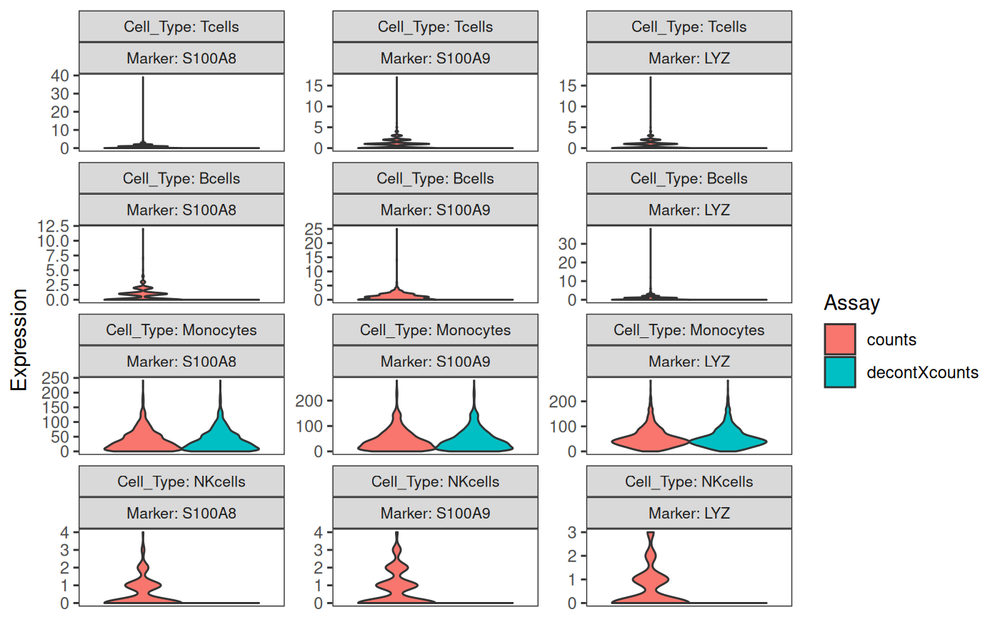
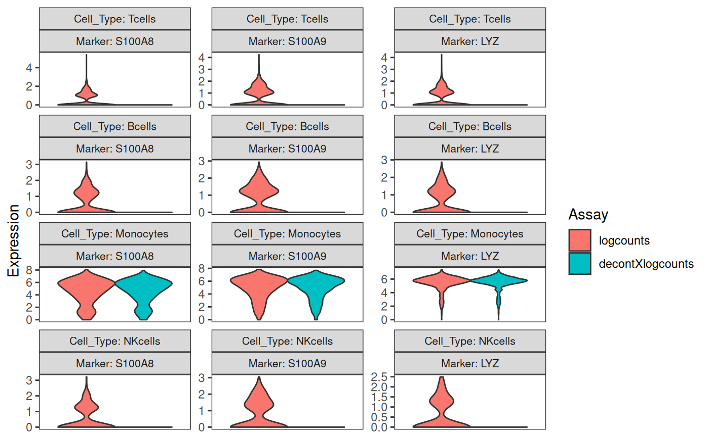
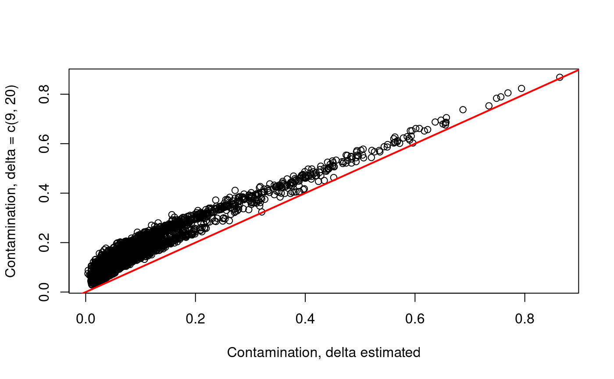

# Decontamination of ambient RNA in single-cell genomic data with DecontX

## Introduction

Droplet-based microfluidic devices have become widely used to perform
single-cell RNA sequencing (scRNA-seq). However, ambient RNA present in
the cell suspension can be aberrantly counted along with a cell’s native
mRNA and result in cross-contamination of transcripts between different
cell populations. DecontX is a Bayesian method to estimate and remove
contamination in individual cells. DecontX assumes the observed
expression of a cell is a mixture of counts from two multinomial
distributions: (1) a distribution of native transcript counts from the
cell’s actual population and (2) a distribution of contaminating
transcript counts from all other cell populations captured in the assay.
Overall, computational decontamination of single cell counts can aid in
downstream clustering and visualization.

For a short overview of the package and of DecontPro, its method for
protein (ADT) data, see [Getting started with
decontX](https://campbio.github.io/decontX/dev/articles/decontX.md),
[`vignette("decontX", package = "decontX")`](https://campbio.github.io/decontX/dev/articles/decontX.md).

## Installation

The decontX package can be installed from Bioconductor:

\
`if`` ``(``!`[`requireNamespace`](https://rdrr.io/r/base/ns-load.html)`(``"BiocManager"``, quietly ``=`` ``TRUE``)``)`` ``{`\
`    `[`install.packages`](https://rdrr.io/r/utils/install.packages.html)`(``"BiocManager"``)`\
`}`\
`BiocManager``::`[`install`](https://bioconductor.github.io/BiocManager/reference/install.html)`(``"decontX"``)`

Then the package can be loaded in R using the following command:

\
[`library`](https://rdrr.io/r/base/library.html)`(`[`decontX`](https://campbio.github.io/decontX/)`)`

To see the latest updates and releases or to post a bug, see our GitHub
page at <https://github.com/campbio/decontX>.

## Importing data

DecontX can take either a
[SingleCellExperiment](https://bioconductor.org/packages/release/bioc/html/SingleCellExperiment.html)
object or a counts matrix as input. `decontX` will attempt to convert
any input matrix to class `dgCMatrix` from package
[Matrix](https://cran.r-project.org/web/packages/Matrix/index.html)
before starting the analysis.

To import datasets directly into an SCE object, the
[singleCellTK](https://bioconductor.org/packages/release/bioc/html/singleCellTK.html)
package has several importing functions for different preprocessing
tools including CellRanger, STARsolo, BUStools, Optimus, DropEST, SEQC,
and Alevin/Salmon. For example, the following code can be used as a
template to read in the filtered matrices for multiple samples processed
with CellRanger:

\
[`library`](https://rdrr.io/r/base/library.html)`(``singleCellTK``)`\
`sce`` ``<-`` ``importCellRanger``(``sampleDirs ``=`` `[`c`](https://rdrr.io/r/base/c.html)`(``"path/to/sample1/"``, ``"path/to/sample2/"``)``)`

Within each sample directory, there should be subfolders called
`"outs/filtered_feature_bc_matrix/"` or `"outs/raw_feature_bc_matrix/"`
with files called `matrix.mtx.gz`, `features.tsv.gz` and
`barcodes.tsv.gz`. If these files are in different subdirectories, the
`importCellRangerV3Sample` function can be used to import data from a
different directory instead.

The “raw” or “droplet” matrix, which also holds the empty droplets, can
be imported the same way and passed to the `background` parameter, as
shown in [With the background matrix](#background). If using Seurat, go
to the [Working with Seurat](#seurat) section for details on how to
convert between SCE and Seurat objects.

## Load PBMC4k data from 10X

We will utilize the 10X PBMC 4K dataset as an example in this vignette.
This data can be easily retrieved from the package
[TENxPBMCData](http://bioconductor.org/packages/release/data/experiment/html/TENxPBMCData.md).
Make sure the column names are set before running decontX.

\
`# Load PBMC data`\
[`library`](https://rdrr.io/r/base/library.html)`(``TENxPBMCData``)`

    ## Warning: replacing previous import 'BiocGenerics::version' by
    ## 'BiocManager::version' when loading 'AnnotationHub'

\
`sce`` ``<-`` `[`TENxPBMCData`](https://rdrr.io/pkg/TENxPBMCData/man/TENxPBMCData.html)`(``"pbmc4k"``)`

\
[`colnames`](https://rdrr.io/r/base/colnames.html)`(``sce``)`` ``<-`` `[`paste`](https://rdrr.io/r/base/paste.html)`(``sce``$``Sample``, ``sce``$``Barcode``, sep ``=`` ``"_"``)`\
[`rownames`](https://rdrr.io/r/base/colnames.html)`(``sce``)`` ``<-`` `[`rowData`](https://rdrr.io/pkg/SummarizedExperiment/man/SummarizedExperiment-class.html)`(``sce``)``$``Symbol_TENx`\
[`counts`](https://rdrr.io/pkg/BiocGenerics/man/dge.html)`(``sce``)`` ``<-`` ``as``(`[`counts`](https://rdrr.io/pkg/BiocGenerics/man/dge.html)`(``sce``)``, ``"dgCMatrix"``)`

## Running decontX

A SingleCellExperiment (SCE) object or a sparse matrix containing the
counts for filtered cells can be passed to decontX via the `x`
parameter. The matrix to use in an SCE object can be specified with the
`assayName` parameter, which is set to `"counts"` by default. There are
two major ways to run decontX: without and with the raw/droplet matrix
containing empty droplets.

### Without the background matrix

Here is an example of running decontX without supplying the background:

\
`sce`` ``<-`` `[`decontX`](https://campbio.github.io/decontX/dev/reference/decontX.md)`(``sce``)`

In this scenario, `decontX` will estimate the contamination distribution
for each cell cluster based on the profiles of the other cell clusters
in the filtered dataset. The estimated contamination results can be
found in the `colData(sce)$decontX_contamination` and the decontaminated
counts can be accessed with `decontXcounts(sce)`. `decontX` will perform
heuristic clustering to quickly define major cell clusters. However if
you have your own cell cluster labels, they can be specified with the
`z` parameter. These results will be used throughout the rest of the
vignette.

> **Note on reproducing results from older versions:** As of decontX
> 1.11.1, the heuristic clustering used when `z` is not supplied
> (log-normalization, variable gene selection, PCA, and UMAP) is
> performed with the
> [scrapper](https://bioconductor.org/packages/scrapper/) package
> instead of scater/scuttle, whose normalization functions were
> deprecated in Bioconductor 3.24. The workflow and parameters are
> unchanged, but contamination estimates may differ slightly from
> versions 1.11.0 and earlier because the UMAP embedding used for the
> initial clustering differs. To reproduce results from older versions,
> set `legacyInit = TRUE`. This option requires the scater package and
> is kept for backwards compatibility; it will remain available as long
> as the underlying functions are still provided by scater/scuttle.
> Results are identical between versions when cluster labels are
> supplied with `z`.

### With the background matrix

The raw/droplet matrix can be used to empirically estimate the
distribution of ambient RNA, which is especially useful when cells that
contributed to the ambient RNA are not accurately represented in the
filtered count matrix containing the cells. For example, cells that were
removed via flow cytometry or that were more sensitive to lysis during
dissociation may have contributed to the ambient RNA but were not
measured in the filtered/cell matrix.

The raw matrix holds every droplet barcode, including the empty
droplets. For data processed with CellRanger, it is in the
`"outs/raw_feature_bc_matrix/"` subfolder of each sample directory, and
singleCellTK imports it when the `dataType` argument is set to “raw”.
The PBMC4k data used in this vignette don’t include the raw matrix, so
this code is a template: replace the paths with your own sample
directories, the same ones used to import the filtered matrix. The raw
matrix can then be passed to decontX as an SCE object or a sparse matrix
with the `background` parameter:

\
`# Import the raw matrix, which includes the empty droplets`\
[`library`](https://rdrr.io/r/base/library.html)`(``singleCellTK``)`\
`sce.raw`` ``<-`` ``importCellRanger``(`\
`    sampleDirs ``=`` `[`c`](https://rdrr.io/r/base/c.html)`(``"path/to/sample1/"``, ``"path/to/sample2/"``)``,`\
`    dataType ``=`` ``"raw"``)`\
\
`# Estimate the ambient RNA from the empty droplets`\
`sce`` ``<-`` `[`decontX`](https://campbio.github.io/decontX/dev/reference/decontX.md)`(``sce``, background ``=`` ``sce.raw``)`

Only empty droplets in the background matrix should be used to estimate
the ambient RNA. If any cell ids (i.e. `colnames`) in the raw/droplet
matrix supplied to the `background` parameter are also found in the
filtered counts matrix (`x`), decontX will automatically remove them
from the raw matrix. With `batch` and `bgBatch`, the cell ids are
matched within each batch, so a barcode that is a cell in one sample can
still be an empty droplet in another. If either matrix has no cell ids,
nothing can be removed and decontX gives a warning. It also warns when
no cell id matches but the background has many droplets with as many
counts as a typical cell, which happens when the two matrices name the
same barcodes differently, for example with and without a sample prefix.

When both matrices have gene names (row names), genes are matched by
name: genes in the background that are not in `x` are dropped, and genes
in `x` that are missing from the background give an error. Matching by
name needs unique names: if the two matrices have different row names
and either has a duplicated name, decontX stops with an error. Gene
symbols are sometimes duplicated, so use gene IDs, or
[`make.unique()`](https://rdrr.io/r/base/make.unique.html) on both.
Without gene names, the rows must be in the same order.

All of the outputs are the same as when running decontX without setting
the `background` parameter.

> Note: If the input object is just a matrix and not an SCE object, make
> sure to save the output into a variable with a different name (e.g.
> `result <- decontX(mat)`). The result object will be a list with
> contamination in `result$contamination` and the decontaminated counts
> in `result$decontXcounts`.

## Plotting DecontX results

### Cluster labels on UMAP

DecontX creates a UMAP which we can use to plot the cluster labels
automatically identified in the analysis. Note that the clustering
approach used here is designed to find “broad” cell types rather than
individual cell subpopulations within a cell type.

\
[`library`](https://rdrr.io/r/base/library.html)`(`[`scater`](http://bioconductor.org/packages/scater/)`)`

    ## Loading required package: scuttle

    ## Loading required package: ggplot2

\
[`plotReducedDim`](https://rdrr.io/pkg/scater/man/plotReducedDim.html)`(``sce``, dimred ``=`` ``"decontX_UMAP"``,`\
`    colour_by ``=`` ``"decontX_clusters"``, text_by ``=`` ``"decontX_clusters"``)`

### Contamination on UMAP

The proportion of contamination in each cell, between 0 and 1, can be
plotted on the UMAP to visualize which clusters may have higher levels
of ambient RNA.

\
[`plotDecontXContamination`](https://campbio.github.io/decontX/dev/reference/plotDecontXContamination.md)`(``sce``)`

### Expression of markers on UMAP

Known marker genes can also be plotted on the UMAP to identify the cell
types for each cluster. We will use one marker for each cell type: CD3D
for T-cells, MS4A1 for B-cells, LYZ for monocytes, and GNLY for
NK-cells. Raw counts depend on how many transcripts were captured in
each cell, so we first log-normalize them: divide each cell’s counts by
its size factor (its total counts relative to the average cell) and take
the log. The normalized values are stored in the `logcounts` assay,
which the plots use.

\
`# Matrix provides colSums() for sparse count matrices.`\
`# Load scrapper after scater so that normalizeCounts() below refers to`\
`# scrapper's function and not the deprecated scuttle version that scater`\
`# attaches. patchwork combines several plots into one figure.`\
[`library`](https://rdrr.io/r/base/library.html)`(`[`Matrix`](https://codeberg.org/jaganmn/Matrix)`)`\
[`library`](https://rdrr.io/r/base/library.html)`(`[`scrapper`](https://github.com/libscran/scrapper)`)`\
[`library`](https://rdrr.io/r/base/library.html)`(`[`patchwork`](https://patchwork.data-imaginist.com)`)`\
\
`# The total counts of each cell (its library size)`\
`librarySizes`` ``<-`` `[`colSums`](https://rdrr.io/pkg/Matrix/man/colSums-methods.html)`(`[`counts`](https://rdrr.io/pkg/BiocGenerics/man/dge.html)`(``sce``)``)`\
\
`# Size factors: library sizes scaled to have a mean of 1`\
`sizeFactors`` ``<-`` `[`centerSizeFactors`](https://rdrr.io/pkg/scrapper/man/centerSizeFactors.html)`(``librarySizes``)`\
\
`# Log-normalize the original counts`\
[`logcounts`](https://rdrr.io/pkg/SingleCellExperiment/man/assays.html)`(``sce``)`` ``<-`` `[`normalizeCounts`](https://rdrr.io/pkg/scrapper/man/normalizeCounts.html)`(`[`counts`](https://rdrr.io/pkg/BiocGenerics/man/dge.html)`(``sce``)``, size.factors ``=`` ``sizeFactors``)`\
\
`# Plot the expression of each marker on the UMAP`\
`tcellPlot`` ``<-`` `[`plotReducedDim`](https://rdrr.io/pkg/scater/man/plotReducedDim.html)`(``sce``, dimred ``=`` ``"decontX_UMAP"``, colour_by ``=`` ``"CD3D"``)`\
`bcellPlot`` ``<-`` `[`plotReducedDim`](https://rdrr.io/pkg/scater/man/plotReducedDim.html)`(``sce``, dimred ``=`` ``"decontX_UMAP"``, colour_by ``=`` ``"MS4A1"``)`\
`monocytePlot`` ``<-`` `[`plotReducedDim`](https://rdrr.io/pkg/scater/man/plotReducedDim.html)`(``sce``, dimred ``=`` ``"decontX_UMAP"``, colour_by ``=`` ``"LYZ"``)`\
`nkcellPlot`` ``<-`` `[`plotReducedDim`](https://rdrr.io/pkg/scater/man/plotReducedDim.html)`(``sce``, dimred ``=`` ``"decontX_UMAP"``, colour_by ``=`` ``"GNLY"``)`\
\
`# Show the four plots together`\
[`wrap_plots`](https://patchwork.data-imaginist.com/reference/wrap_plots.html)`(``tcellPlot``, ``bcellPlot``, ``monocytePlot``, ``nkcellPlot``, ncol ``=`` ``2``)`

### Barplot of markers detected in cell clusters

The percentage of cells within a cluster that have detectable expression
of marker genes can be displayed in a barplot. Markers for cell types
need to be supplied in a named list:

\
`markers`` ``<-`` `[`list`](https://rdrr.io/r/base/list.html)`(``Tcell_Markers ``=`` `[`c`](https://rdrr.io/r/base/c.html)`(``"CD3E"``, ``"CD3D"``)``,`\
`    Bcell_Markers ``=`` `[`c`](https://rdrr.io/r/base/c.html)`(``"CD79A"``, ``"CD79B"``, ``"MS4A1"``)``,`\
`    Monocyte_Markers ``=`` `[`c`](https://rdrr.io/r/base/c.html)`(``"S100A8"``, ``"S100A9"``, ``"LYZ"``)``,`\
`    NKcell_Markers ``=`` ``"GNLY"``)`

First, the detection of marker genes in the original `counts` assay is
shown for each cluster. A cell counts as expressing a cell type’s
markers when at least one of them is detected:

\
[`plotDecontXMarkerPercentage`](https://campbio.github.io/decontX/dev/reference/plotDecontXMarkerPercentage.md)`(``sce``,`\
`    markers ``=`` ``markers``,`\
`    assayName ``=`` ``"counts"``)`

Most cell types stand out in this plot: the T-cell markers, for example,
are detected in almost every cell of one cluster and in far fewer cells
of the others. The monocyte markers, though, are detected in most cells
of every cluster. They are highly expressed in monocytes, which makes
them a large part of the ambient RNA: this is the contamination that
decontX removes.

To label the plots by cell type instead of by cluster number, the
barplot functions take a `groupClusters` argument: a named list that
maps each cell type to the cluster label(s) it corresponds to.

The cluster numbers assigned by the heuristic clustering can differ
between decontX versions and platforms, so rather than typing them in,
the code below finds, for each cell type, the cluster where its markers
have the highest average count. The average count works better than
detection here, since contaminating markers are often detected but at
low counts:

\
`# The cluster label of each cell`\
`clusters`` ``<-`` ``sce``$``decontX_clusters`\
\
`# The total count of each cell type's markers in each cell`\
`tcellCounts`` ``<-`` `[`colSums`](https://rdrr.io/pkg/Matrix/man/colSums-methods.html)`(`[`counts`](https://rdrr.io/pkg/BiocGenerics/man/dge.html)`(``sce``)``[``markers``$``Tcell_Markers``, ``]``)`\
`bcellCounts`` ``<-`` `[`colSums`](https://rdrr.io/pkg/Matrix/man/colSums-methods.html)`(`[`counts`](https://rdrr.io/pkg/BiocGenerics/man/dge.html)`(``sce``)``[``markers``$``Bcell_Markers``, ``]``)`\
`monocyteCounts`` ``<-`` `[`colSums`](https://rdrr.io/pkg/Matrix/man/colSums-methods.html)`(`[`counts`](https://rdrr.io/pkg/BiocGenerics/man/dge.html)`(``sce``)``[``markers``$``Monocyte_Markers``, ``]``)`\
`# The NK-cell set has one marker, so its counts need no colSums()`\
`nkcellCounts`` ``<-`` `[`counts`](https://rdrr.io/pkg/BiocGenerics/man/dge.html)`(``sce``)``[``markers``$``NKcell_Markers``, ``]`\
\
`# The average of those counts in each cluster`\
`tcellAverage`` ``<-`` `[`tapply`](https://rdrr.io/r/base/tapply.html)`(``tcellCounts``, ``clusters``, ``mean``)`\
`bcellAverage`` ``<-`` `[`tapply`](https://rdrr.io/r/base/tapply.html)`(``bcellCounts``, ``clusters``, ``mean``)`\
`monocyteAverage`` ``<-`` `[`tapply`](https://rdrr.io/r/base/tapply.html)`(``monocyteCounts``, ``clusters``, ``mean``)`\
`nkcellAverage`` ``<-`` `[`tapply`](https://rdrr.io/r/base/tapply.html)`(``nkcellCounts``, ``clusters``, ``mean``)`\
\
`# For each cell type, the cluster with the highest average`\
`cellTypeMappings`` ``<-`` `[`list`](https://rdrr.io/r/base/list.html)`(`\
`    Tcells ``=`` `[`names`](https://rdrr.io/r/base/names.html)`(`[`which.max`](https://rdrr.io/r/base/which.min.html)`(``tcellAverage``)``)``,`\
`    Bcells ``=`` `[`names`](https://rdrr.io/r/base/names.html)`(`[`which.max`](https://rdrr.io/r/base/which.min.html)`(``bcellAverage``)``)``,`\
`    Monocytes ``=`` `[`names`](https://rdrr.io/r/base/names.html)`(`[`which.max`](https://rdrr.io/r/base/which.min.html)`(``monocyteAverage``)``)``,`\
`    NKcells ``=`` `[`names`](https://rdrr.io/r/base/names.html)`(`[`which.max`](https://rdrr.io/r/base/which.min.html)`(``nkcellAverage``)``)``)`\
`cellTypeMappings`

    ## $Tcells
    ## [1] "2"
    ## 
    ## $Bcells
    ## [1] "4"
    ## 
    ## $Monocytes
    ## [1] "1"
    ## 
    ## $NKcells
    ## [1] "5"

You can also build this list by hand: look at the barplot above, decide
which cluster corresponds to each cell type, and write it out. For
example, if T-cells were cluster 2, B-cells cluster 4, monocytes cluster
1 and NK-cells cluster 5, the list would be
`list(Tcells = "2", Bcells = "4", Monocytes = "1", NKcells = "5")`. A
single cell type can also span several clusters: give it a vector of
cluster labels. For example, if T-cells had been split into clusters 2
and 3, `Tcells = c("2", "3")` would group them together. Clusters left
out of the list are left out of the plots.

Now the detection of marker genes in the original `counts` assay can be
shown for each cell type:

\
[`plotDecontXMarkerPercentage`](https://campbio.github.io/decontX/dev/reference/plotDecontXMarkerPercentage.md)`(``sce``,`\
`    markers ``=`` ``markers``,`\
`    groupClusters ``=`` ``cellTypeMappings``,`\
`    assayName ``=`` ``"counts"``)`

We can then look to see how much decontX removed aberrant expression of
marker genes in each cell type by changing the `assayName` to
`decontXcounts`:

\
[`plotDecontXMarkerPercentage`](https://campbio.github.io/decontX/dev/reference/plotDecontXMarkerPercentage.md)`(``sce``,`\
`    markers ``=`` ``markers``,`\
`    groupClusters ``=`` ``cellTypeMappings``,`\
`    assayName ``=`` ``"decontXcounts"``)`

Percentages of marker genes detected in other cell types were reduced or
completely removed. For example, the percentage of cells that expressed
Monocyte marker genes was greatly reduced in T-cells, B-cells, and
NK-cells. The original counts and decontaminated counts can be plotted
side-by-side by listing multiple assays in the `assayName` parameter.
This option is only available if the data is stored in a
`SingleCellExperiment` object.

\
[`plotDecontXMarkerPercentage`](https://campbio.github.io/decontX/dev/reference/plotDecontXMarkerPercentage.md)`(``sce``,`\
`    markers ``=`` ``markers``,`\
`    groupClusters ``=`` ``cellTypeMappings``,`\
`    assayName ``=`` `[`c`](https://rdrr.io/r/base/c.html)`(``"counts"``, ``"decontXcounts"``)``)`

Some helpful hints when using `plotDecontXMarkerPercentage`:

1.  `groupClusters` renames and re-groups clusters, as described above.
    For example, to group T-cells and NK-cells together, list both of
    their clusters under one name, such as
    `list(NK_Tcells = c("2", "5"), Bcells = "4", Monocytes = "1")`,
    using your own cluster labels.
2.  The count at which a gene is considered detected in a cell can be
    adjusted using the `threshold` parameter.
3.  If you are not using a `SingleCellExperiment`, then you will need to
    supply the original counts matrix or the decontaminated counts
    matrix as the first argument to generate the barplots.

### Violin plot to compare the distributions of original and decontaminated counts

Another useful way to assess the amount of decontamination is to view
the expression of marker genes before and after `decontX` across cell
types. Here we view the monocyte markers in each cell type. The violin
plot shows that the markers have been removed from T-cells, B-cells, and
NK-cells, but are largely unaffected in monocytes.

\
[`plotDecontXMarkerExpression`](https://campbio.github.io/decontX/dev/reference/plotDecontXMarkerExpression.md)`(``sce``,`\
`    markers ``=`` ``markers``[[``"Monocyte_Markers"``]``]``,`\
`    groupClusters ``=`` ``cellTypeMappings``,`\
`    ncol ``=`` ``3``)`

Some helpful hints when using `plotDecontXMarkerExpression`:

1.  `groupClusters` works the same way as in
    `plotDecontXMarkerPercentage`.
2.  This function will plot each pair of markers and clusters (or cell
    type specified by `groupClusters`). Therefore, you may want to keep
    the number of markers small in each plot and call the function
    multiple times for different sets of marker genes.
3.  You can also plot the individual points by setting `plotDots = TRUE`
    and/or log transform the points on the fly by setting
    `log1p = TRUE`.
4.  This function can plot any assay in a `SingleCellExperiment`.
    Therefore you could also examine normalized expression of the
    original and decontaminated counts. For example:

\
`# Size factors from the decontaminated library sizes`\
`decontLibrarySizes`` ``<-`` `[`colSums`](https://rdrr.io/pkg/Matrix/man/colSums-methods.html)`(`[`decontXcounts`](https://campbio.github.io/decontX/dev/reference/decontXcounts.md)`(``sce``)``)`\
`decontSizeFactors`` ``<-`` `[`centerSizeFactors`](https://rdrr.io/pkg/scrapper/man/centerSizeFactors.html)`(``decontLibrarySizes``)`\
\
`# Log-normalize the decontaminated counts`\
[`assay`](https://rdrr.io/pkg/SummarizedExperiment/man/SummarizedExperiment-class.html)`(``sce``, ``"decontXlogcounts"``)`` ``<-`` `[`normalizeCounts`](https://rdrr.io/pkg/scrapper/man/normalizeCounts.html)`(`[`decontXcounts`](https://campbio.github.io/decontX/dev/reference/decontXcounts.md)`(``sce``)``,`\
`    size.factors ``=`` ``decontSizeFactors``)`\
\
[`plotDecontXMarkerExpression`](https://campbio.github.io/decontX/dev/reference/plotDecontXMarkerExpression.md)`(``sce``,`\
`    markers ``=`` ``markers``[[``"Monocyte_Markers"``]``]``,`\
`    groupClusters ``=`` ``cellTypeMappings``,`\
`    ncol ``=`` ``3``,`\
`    assayName ``=`` `[`c`](https://rdrr.io/r/base/c.html)`(``"logcounts"``, ``"decontXlogcounts"``)``)`

## Other important notes

### Working with Seurat

If you are using the
[Seurat](https://cran.r-project.org/web/packages/Seurat/index.html)
package for downstream analysis, the following code can be used to read
in a matrix and convert between Seurat and SCE objects:

\
`# Read counts from CellRanger output`\
[`library`](https://rdrr.io/r/base/library.html)`(`[`Seurat`](https://satijalab.org/seurat)`)`\
[`library`](https://rdrr.io/r/base/library.html)`(`[`SingleCellExperiment`](https://github.com/drisso/SingleCellExperiment)`)`\
`counts`` ``<-`` `[`Read10X`](https://satijalab.org/seurat/reference/Read10X.html)`(``"sample/outs/filtered_feature_bc_matrix/"``)`\
\
`# Create a SingleCellExperiment object and run decontX`\
`sce`` ``<-`` `[`SingleCellExperiment`](https://rdrr.io/pkg/SingleCellExperiment/man/SingleCellExperiment.html)`(`[`list`](https://rdrr.io/r/base/list.html)`(``counts ``=`` ``counts``)``)`\
`sce`` ``<-`` `[`decontX`](https://campbio.github.io/decontX/dev/reference/decontX.md)`(``sce``)`\
\
`# Create a Seurat object from a SCE with decontX results`\
`seuratObject`` ``<-`` `[`CreateSeuratObject`](https://satijalab.github.io/seurat-object/reference/CreateSeuratObject.html)`(`[`round`](https://rdrr.io/r/base/Round.html)`(`[`decontXcounts`](https://campbio.github.io/decontX/dev/reference/decontXcounts.md)`(``sce``)``)``)`

Optionally, the “raw” matrix can also be imported and used as the
background:

\
`counts.raw`` ``<-`` `[`Read10X`](https://satijalab.org/seurat/reference/Read10X.html)`(``"sample/outs/raw_feature_bc_matrix/"``)`\
`sce.raw`` ``<-`` `[`SingleCellExperiment`](https://rdrr.io/pkg/SingleCellExperiment/man/SingleCellExperiment.html)`(`[`list`](https://rdrr.io/r/base/list.html)`(``counts ``=`` ``counts.raw``)``)`\
`sce`` ``<-`` `[`decontX`](https://campbio.github.io/decontX/dev/reference/decontX.md)`(``sce``, background ``=`` ``sce.raw``)`

Note that the decontaminated matrix of decontX consists of floating
point numbers and must be rounded to integers before adding it to a
Seurat object. If you already have a Seurat object containing the counts
matrix and would like to run decontX, you can retrieve the count matrix,
create a SCE object, and run decontX, and then add it back to the Seurat
object:

\
`# Retrieve the counts matrix from the Seurat object`\
[`library`](https://rdrr.io/r/base/library.html)`(`[`Seurat`](https://satijalab.org/seurat)`)`\
[`library`](https://rdrr.io/r/base/library.html)`(`[`SingleCellExperiment`](https://github.com/drisso/SingleCellExperiment)`)`\
`counts`` ``<-`` `[`LayerData`](https://satijalab.github.io/seurat-object/reference/Layers.html)`(``seuratObject``, assay ``=`` ``"RNA"``, layer ``=`` ``"counts"``)`\
\
`# Create a SingleCellExperiment object and run decontX`\
`sce`` ``<-`` `[`SingleCellExperiment`](https://rdrr.io/pkg/SingleCellExperiment/man/SingleCellExperiment.html)`(`[`list`](https://rdrr.io/r/base/list.html)`(``counts ``=`` ``counts``)``)`\
`sce`` ``<-`` `[`decontX`](https://campbio.github.io/decontX/dev/reference/decontX.md)`(``sce``)`\
\
`# Add the rounded decontaminated counts to the Seurat object as a new assay`\
`decontCounts`` ``<-`` `[`round`](https://rdrr.io/r/base/Round.html)`(`[`decontXcounts`](https://campbio.github.io/decontX/dev/reference/decontXcounts.md)`(``sce``)``)`\
`seuratObject``[[``"decontXcounts"``]``]`` ``<-`` `[`CreateAssayObject`](https://satijalab.github.io/seurat-object/reference/CreateAssayObject.html)`(``counts ``=`` ``decontCounts``)`

### Running decontX on multiple samples

Give decontX the sample of each cell with the `batch` parameter. Each
sample is then decontaminated on its own, which is what you want: the
ambient RNA differs between samples. If you have already annotated your
cells, give those labels with `z`; then `embedding = FALSE` skips the
UMAP, which saves most of the run time on large data sets. Here `sample`
and `cellType` stand for columns in your own `colData`:

\
`sce`` ``<-`` `[`decontX`](https://campbio.github.io/decontX/dev/reference/decontX.md)`(``sce``,`\
`    batch ``=`` ``sce``$``sample``,`\
`    z ``=`` ``sce``$``cellType``,`\
`    embedding ``=`` ``FALSE``)`

If any label in `z` appears in more than one sample, all labels come
back with their sample in front of them in `sce$decontX_clusters` (for
example `"sample1-Tcells"`), since the same label may describe different
clusters in different samples. If you use `background`, give the sample
of each empty droplet with `bgBatch`.

If the combined data are too large to hold in memory, you can instead
run decontX on each sample separately and combine the decontaminated
counts afterwards. This gives the same contamination estimates and
decontaminated counts as one run with `batch`; the cluster labels just
come back without the sample in front. With `background`, give each run
only the empty droplets of its own sample.

### Choosing appropriate cell clusters

The ability of DecontX to accurately identify contamination is dependent
on the cell cluster labels. DecontX assumes that contamination for a
cell cluster comes from a combination of counts from all other clusters.
The default clustering approach used by DecontX tends to select fewer
clusters that represent broader cell types. For example, all T-cells
tend to be clustered together rather than splitting naive and cytotoxic
T-cells into separate clusters. Custom cell type labels can be supplied
via the `z` parameter if some cells are not being clustered
appropriately by the default method.

### Adjusting the priors to influence contamination estimates

There are ways to force `decontX` to estimate more or less contamination
across a dataset by manipulating the priors. The `delta` parameter is a
numeric vector of length two. It is the concentration parameter for the
Dirichlet distribution which serves as the prior for the proportions of
native and contamination counts in each cell. The first element is the
prior for the proportion of native counts while the second element is
the prior for the proportion of contamination counts. These essentially
act as pseudocounts for the native and contamination in each cell. If
`estimateDelta = TRUE`, `delta` is only used to produce a random sample
of proportions for an initial value of contamination in each cell. Then
`delta` is updated in each iteration. If `estimateDelta = FALSE`, then
`delta` is fixed with these values for the entire inference procedure.
Fixing `delta` and setting a high number in the second element will
force `decontX` to be more aggressive and estimate higher levels of
contamination in each cell at the expense of potentially removing native
expression. For example, in the previous PBMC example, we can see what
the estimated `delta` was by looking in the estimates. They are stored
for each batch; without `batch`, all cells form one batch called
`all_cells`:

\
`metadata``(``sce``)``$``decontX``$``estimates``$``all_cells``$``delta`

    ## [1] 9.279698 1.047306

Setting a higher value in the second element of delta and
`estimateDelta = FALSE` will force `decontX` to estimate higher levels
of contamination per cell. To compare the two runs fairly, we give the
second run the clusters from the first with `z`. Since the clusters are
already known, `embedding = FALSE` skips the UMAP, which saves most of
the run time:

\
`sce.delta`` ``<-`` `[`decontX`](https://campbio.github.io/decontX/dev/reference/decontX.md)`(``sce``,`\
`    z ``=`` ``sce``$``decontX_clusters``,`\
`    delta ``=`` `[`c`](https://rdrr.io/r/base/c.html)`(``9``, ``20``)``,`\
`    estimateDelta ``=`` ``FALSE``,`\
`    embedding ``=`` ``FALSE``)`\
\
[`plot`](https://rdrr.io/r/graphics/plot.default.html)`(``sce``$``decontX_contamination``, ``sce.delta``$``decontX_contamination``,`\
`     xlab ``=`` ``"Contamination, delta estimated"``,`\
`     ylab ``=`` ``"Contamination, delta = c(9, 20)"``)`\
[`abline`](https://rdrr.io/r/graphics/abline.html)`(``0``, ``1``, col ``=`` ``"red"``, lwd ``=`` ``2``)`

Each point is a cell. Points above the red line have a higher estimated
contamination with the fixed priors than with the estimated ones.

## Frequently asked questions

### My data has only one cell type. Can I use decontX?

Without `background`, decontX learns the contamination by comparing
clusters, so it needs at least two of them; with one cell type, it will
split that cell type into clusters that aren’t real. With
[`background`](#background), the contamination profile comes from the
empty droplets instead, so a single cluster is allowed. Give every cell
the same label with `z`, and skip the UMAP with `embedding = FALSE`,
since the clusters are already given:

\
`sce`` ``<-`` `[`decontX`](https://campbio.github.io/decontX/dev/reference/decontX.md)`(``sce``,`\
`    background ``=`` ``sce.raw``,`\
`    z ``=`` `[`rep`](https://rdrr.io/r/base/rep.html)`(``1``, `[`ncol`](https://rdrr.io/r/base/nrow.html)`(``sce``)``)``,`\
`    embedding ``=`` ``FALSE``)`

### Should I run doublet detection before or after decontX?

Run both on the same original counts. Run your doublet detector (for
example scDblFinder or scds) on the original filtered counts, not on
decontaminated counts. Doublet detectors are designed for raw integer
counts, and decontX changes exactly what they look for: when a doublet
is grouped with one of its two cell types, decontX treats the other
cell’s transcripts as contamination and removes them, so the doublet
looks like a single cell afterwards.

It’s fine when decontX and a doublet detector flag some of the same
cells. High decontX contamination can itself indicate a doublet: in Yang
et al. (2020), every cell with more than 70% estimated contamination was
also called a doublet by Scrublet. Use both results together when you
decide which cells to remove.

## Citing decontX

If you use DecontX in your work, please cite:

Yang S, Corbett SE, Koga Y, Wang Z, Johnson WE, Yajima M, Campbell JD
(2020). Decontamination of ambient RNA in single-cell RNA-seq with
DecontX. *Genome Biology*, 21(1), 57.
[doi:10.1186/s13059-020-1950-6](https://doi.org/10.1186/s13059-020-1950-6)

To decontaminate protein (ADT) counts from CITE-seq, see the decontPro
vignette,
[`vignette("decontPro", package = "decontX")`](https://campbio.github.io/decontX/dev/articles/decontPro.md),
and cite Yin et al. (2024). `citation("decontX")` prints both
references.

## Session Information

\
[`sessionInfo`](https://rdrr.io/r/utils/sessionInfo.html)`(``)`

    ## R version 4.6.1 (2026-06-24)
    ## Platform: x86_64-pc-linux-gnu
    ## Running under: Ubuntu 24.04.5 LTS
    ## 
    ## Matrix products: default
    ## BLAS:   /usr/lib/x86_64-linux-gnu/openblas-pthread/libblas.so.3 
    ## LAPACK: /usr/lib/x86_64-linux-gnu/openblas-pthread/libopenblasp-r0.3.26.so;  LAPACK version 3.12.0
    ## 
    ## locale:
    ##  [1] LC_CTYPE=en_US.UTF-8       LC_NUMERIC=C              
    ##  [3] LC_TIME=en_US.UTF-8        LC_COLLATE=en_US.UTF-8    
    ##  [5] LC_MONETARY=en_US.UTF-8    LC_MESSAGES=en_US.UTF-8   
    ##  [7] LC_PAPER=en_US.UTF-8       LC_NAME=C                 
    ##  [9] LC_ADDRESS=C               LC_TELEPHONE=C            
    ## [11] LC_MEASUREMENT=en_US.UTF-8 LC_IDENTIFICATION=C       
    ## 
    ## time zone: Etc/UTC
    ## tzcode source: system (glibc)
    ## 
    ## attached base packages:
    ## [1] stats4    stats     graphics  grDevices utils     datasets  methods  
    ## [8] base     
    ## 
    ## other attached packages:
    ##  [1] patchwork_1.3.2             scrapper_1.7.11            
    ##  [3] scater_1.41.3               ggplot2_4.0.3              
    ##  [5] scuttle_1.23.2              TENxPBMCData_1.31.0        
    ##  [7] HDF5Array_1.41.6            h5mread_1.5.7              
    ##  [9] rhdf5_2.57.20               DelayedArray_0.39.8        
    ## [11] SparseArray_1.13.5          S4Arrays_1.13.3            
    ## [13] abind_1.4-8                 Matrix_1.7-6               
    ## [15] SingleCellExperiment_1.35.2 SummarizedExperiment_1.43.0
    ## [17] Biobase_2.73.2              GenomicRanges_1.65.4       
    ## [19] Seqinfo_1.3.2               IRanges_2.47.5             
    ## [21] S4Vectors_0.51.10           BiocGenerics_0.59.13       
    ## [23] generics_0.1.4              MatrixGenerics_1.25.0      
    ## [25] matrixStats_1.5.0           decontX_1.11.39            
    ## [27] BiocStyle_2.41.0           
    ## 
    ## loaded via a namespace (and not attached):
    ##   [1] RColorBrewer_1.1-3   jsonlite_2.0.0       magrittr_2.0.5      
    ##   [4] ggbeeswarm_0.7.3     farver_2.1.2         rmarkdown_2.32      
    ##   [7] fs_2.1.0             ragg_1.5.2           vctrs_0.7.3         
    ##  [10] memoise_2.0.1        htmltools_0.5.9      BiocBaseUtils_1.15.1
    ##  [13] AnnotationHub_4.3.3  curl_8.1.0           BiocNeighbors_2.7.3 
    ##  [16] Rhdf5lib_2.1.1       sass_0.4.10          parallelly_1.48.0   
    ##  [19] StanHeaders_2.39.1   bslib_0.12.0         htmlwidgets_1.6.4   
    ##  [22] desc_1.4.3           httr2_1.3.0          cachem_1.1.0        
    ##  [25] lifecycle_1.0.5      pkgconfig_2.0.3      rsvd_1.0.6          
    ##  [28] R6_2.6.1             fastmap_1.2.0        future_1.80.0       
    ##  [31] digest_0.6.39        AnnotationDbi_1.75.2 irlba_2.4.1         
    ##  [34] ExperimentHub_3.3.2  textshaping_1.0.5    RSQLite_3.53.3      
    ##  [37] beachmat_2.29.3      labeling_0.4.3       filelock_1.0.3      
    ##  [40] progressr_1.1.0      httr_1.4.9           compiler_4.6.1      
    ##  [43] bit64_4.8.6          withr_3.0.3          S7_0.2.2            
    ##  [46] inline_0.3.21        BiocParallel_1.47.0  viridis_0.6.5       
    ##  [49] DBI_1.3.0            QuickJSR_1.11.0      pkgbuild_1.4.8      
    ##  [52] rappdirs_0.3.4       loo_2.10.1           tools_4.6.1         
    ##  [55] vipor_0.4.7          otel_0.2.0           beeswarm_0.4.0      
    ##  [58] future.apply_1.21.0  MCMCprecision_0.4.2  glue_1.8.1          
    ##  [61] dbscan_1.2.7         rhdf5filters_1.25.5  grid_4.6.1          
    ##  [64] gtable_0.3.6         ScaledMatrix_1.21.0  BiocSingular_1.29.3 
    ##  [67] sp_2.2-4             XVector_0.53.0       ggrepel_0.9.8       
    ##  [70] BiocVersion_3.24.0   pillar_1.11.1        spam_2.11-4         
    ##  [73] dplyr_1.2.1          BiocFileCache_3.3.3  lattice_0.23-1      
    ##  [76] bit_4.6.0            tidyselect_1.2.1     Biostrings_2.81.9   
    ##  [79] knitr_1.52           gridExtra_2.3.1      bookdown_0.48       
    ##  [82] xfun_0.62            rstan_2.32.7         yaml_2.3.12         
    ##  [85] evaluate_1.0.5       codetools_0.2-20     tibble_3.3.1        
    ##  [88] BiocManager_1.30.27  cli_3.6.6            RcppParallel_6.2.1  
    ##  [91] systemfonts_1.3.2    jquerylib_0.1.4      Rcpp_1.1.2          
    ##  [94] globals_0.20.0       dbplyr_2.6.0         png_0.1-9           
    ##  [97] parallel_4.6.1       rstantools_2.7.1     pkgdown_2.2.1       
    ## [100] blob_1.3.0           dotCall64_1.2        listenv_1.1.0       
    ## [103] viridisLite_0.4.3    scales_1.4.0         SeuratObject_5.4.0  
    ## [106] purrr_1.2.2          crayon_1.5.3         combinat_0.0-9      
    ## [109] rlang_1.3.0          cowplot_1.2.0        KEGGREST_1.53.6
