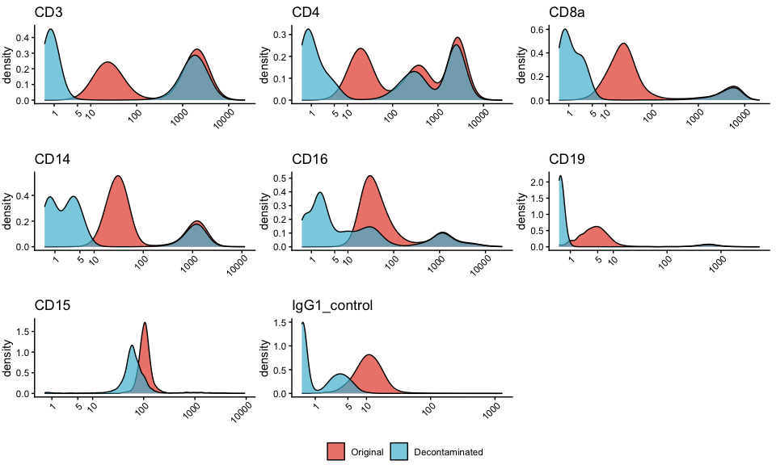
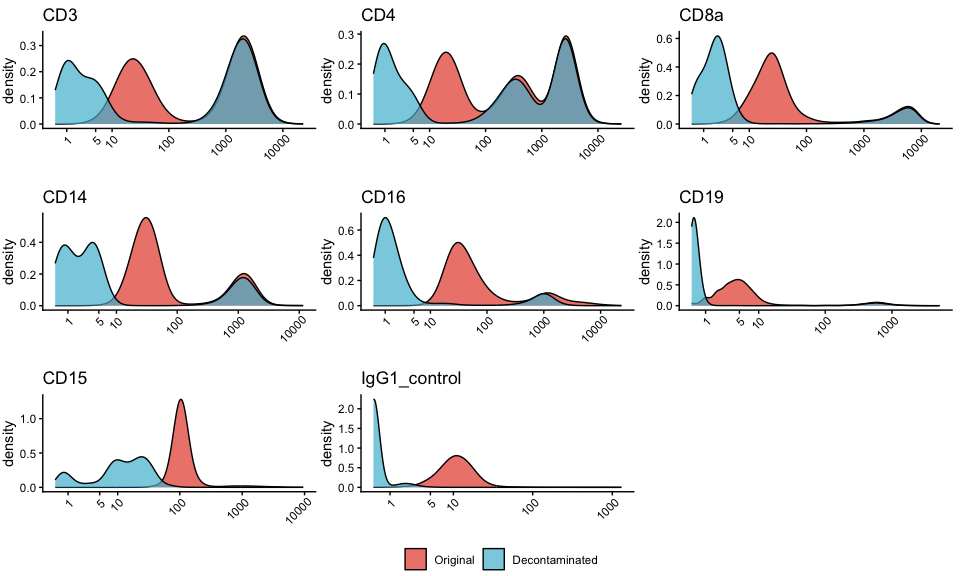
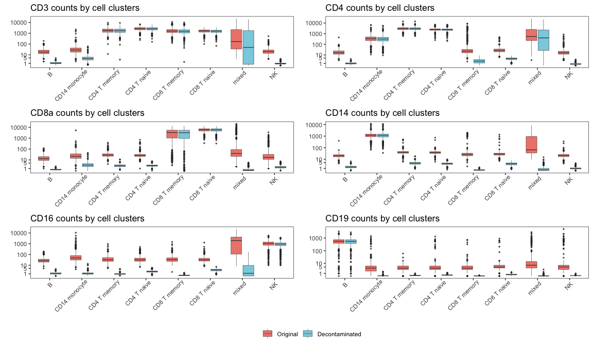
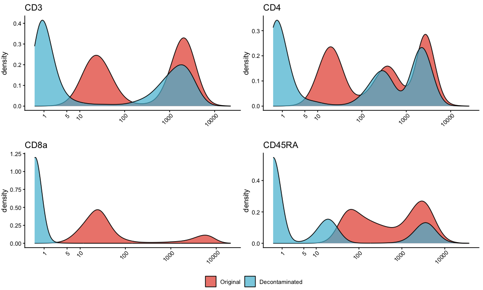

<!-- This is the source of decontPro_pbmc10k.Rmd. Edit this file, not
the .Rmd, then knit it from the package root with
make knit-article FILTER=decontPro_pbmc10k, which runs the code and
writes the .Rmd and its figures. Without that target, knit it in R from
vignettes/articles/, so the figures land next to the .Rmd:
knitr::knit("decontPro_pbmc10k.Rmd.orig", "decontPro_pbmc10k.Rmd") -->


*Computed with decontX 1.11.40 on 2026-11-25.
The code below downloads about 200 MB and takes about ten minutes to
run.*

# Introduction

CITE-seq measures RNA and proteins on the surface of the same cells. The
proteins are measured with antibodies that carry a short DNA tag, called
*antibody-derived tags* (ADTs). Each antibody binds one protein, so
counting its tags shows how much of that protein a cell has. Like RNA,
ADT counts are contaminated. Free antibodies in the liquid end up in
every droplet (*ambient* contamination), and some antibodies stick to
cells that don't have their protein (*background* contamination).
DecontPro estimates both kinds and removes them.

The [DecontPro vignette](decontPro.html) runs DecontPro on 500 cord
blood cells whose cell types are already known. This article runs it on
all the cells of a dataset from 10x Genomics, about 8,000, and covers two
steps the vignette doesn't:

- **Finding the cell types.** DecontPro needs the cell type, or cluster,
  of each cell. Here we find them by grouping cells with similar ADT
  counts (*clustering*).
- **Using the empty droplets.** Most droplets hold no cell. 10x Genomics
  shares the *raw matrix*, which holds every droplet, including these
  empty droplets, so we can give them to DecontPro with the `background`
  argument.

The data also include *isotype controls*: antibodies that bind no
protein on these cells. All of their counts are contamination, so they
show how well DecontPro removes it.

Besides decontX, the code uses these R packages: DropletTestFiles, which
downloads the data; DropletUtils, to read it; bluster, to cluster the
cells; and ggplot2, which makes the plots. `BiocManager::install()`
installs all of them.


``` r
library(decontX)
library(DropletTestFiles)
library(DropletUtils)
library(bluster)
library(ggplot2)
```

# The data

The 10x Genomics dataset is "10k PBMCs from a Healthy Donor - Gene
Expression and Cell Surface Protein". PBMCs (peripheral blood
mononuclear cells) are white blood cells taken from blood: T cells,
B cells, natural killer (NK) cells and monocytes. Along with the RNA,
the data measure 17 ADTs. DropletTestFiles has two versions of the
counts: the *filtered* matrix, with only the droplets that the 10x
software (CellRanger) took to be cells, and the *raw* matrix, with every
droplet. `table()` shows the two kinds of rows: genes ("Gene
Expression") and ADTs ("Antibody Capture"):


``` r
# Find a file of this dataset, downloading it the first time
getFile <- function(file) {
  getTestFile(
    paste0("DropletTestFiles/tenx-3.0.0-pbmc_10k_protein_v3/1.0.0/", file),
    prefix = FALSE
  )
}
filtered <- read10xCounts(getFile("filtered.h5"), col.names = TRUE,
                          type = "HDF5")
raw <- read10xCounts(getFile("raw.h5"), col.names = TRUE, type = "HDF5")
table(rowData(filtered)$Type)
#> 
#> Antibody Capture  Gene Expression 
#>               17            33538
```

DecontPro uses only the ADT counts. The function below keeps the ADT
rows and stores them as a sparse matrix, which saves memory because most
counts are 0. It also shortens the ADT names by removing `_TotalSeqB`,
the name of the antibody kit:


``` r
adtCounts <- function(sce) {
  isAdt <- rowData(sce)$Type == "Antibody Capture"
  x <- as(counts(sce)[isAdt, ], "dgCMatrix")
  rownames(x) <- sub("_TotalSeqB$", "", rowData(sce)$Symbol[isAdt])
  x
}
cells <- adtCounts(filtered)
droplets <- adtCounts(raw)
rownames(cells)
#>  [1] "CD3"           "CD4"           "CD8a"          "CD14"         
#>  [5] "CD15"          "CD16"          "CD56"          "CD19"         
#>  [9] "CD25"          "CD45RA"        "CD45RO"        "PD-1"         
#> [13] "TIGIT"         "CD127"         "IgG2a_control" "IgG1_control" 
#> [17] "IgG2b_control"
```

The ADTs whose names end in `_control` are the isotype controls. A few
cells have no ADT counts at all. Their counts can't be compared with
other cells' (that needs a total above 0), so we drop them:


``` r
# The number of cells with no ADT counts
sum(colSums(cells) == 0)
#> [1] 1
cells <- cells[, colSums(cells) > 0]
# The number of cells left
ncol(cells)
#> [1] 7864
```

The empty droplets are the droplets of the raw matrix that weren't
called as cells. We drop the ones with no ADT counts, which add nothing.
`quantile()` shows how many ADT counts the empty droplets hold: half of
them hold no more than the first number, 90% no more than the second,
and so on:


``` r
empty <- droplets[, !colnames(droplets) %in% colnames(filtered)]
empty <- empty[, colSums(empty) > 0]
# The number of empty droplets
ncol(empty)
#> [1] 664075
quantile(colSums(empty), c(0.5, 0.9, 0.99, 0.999))
#>      50%      90%      99%    99.9% 
#>    1.000  193.000  346.000 5248.852
```

Most empty droplets hold only a few ADT counts, but some hold hundreds.
These are probably *spongelets*: droplets with no cell, but with a bit
of cell membrane or other debris that soaks up antibodies. Because of
them, the mix of ADTs in the empty droplets differs from the mix in the
cells. The table shows each ADT's share of all ADT counts, in percent,
in the cells and in the empty droplets:


``` r
round(cbind(
  cells = rowSums(cells) / sum(cells),
  emptyDroplets = rowSums(empty) / sum(empty)
) * 100, 1)
#>               cells emptyDroplets
#> CD3            18.4           5.2
#> CD4            17.2           4.5
#> CD8a           13.8           3.5
#> CD14            5.5           4.9
#> CD15            2.6          27.8
#> CD16            6.5          22.2
#> CD56            1.4           2.7
#> CD19            1.0           0.8
#> CD25            0.5           1.7
#> CD45RA         24.7          12.3
#> CD45RO          5.6           4.5
#> PD-1            0.6           3.1
#> TIGIT           0.4           1.3
#> CD127           1.3           2.1
#> IgG2a_control   0.1           1.2
#> IgG1_control    0.2           1.6
#> IgG2b_control   0.1           0.7
```

# Finding the cell types from the ADTs

The ADTs here mark the main types of blood cells, so grouping the cells
by their ADT counts finds the cell types, without the RNA. There are
three steps:

1. **Normalize.** Cells differ in their total counts for technical
   reasons. The centered log-ratio (CLR) divides each cell's counts by
   the cell's average count and takes the log, so that cells can be
   compared. We leave out the isotype controls, which say nothing about
   the cell type.
2. **Cluster.** `clusterRows()` links each cell to the 20 cells with the
   most similar ADT levels. It then splits this network into groups of
   cells that are closely linked, with the Louvain method. `resolution`
   sets how many groups it finds. The method uses random numbers, so we
   set a *seed* first, which makes it give the same groups every time.
3. **Name the clusters** from their markers, in the next section.


``` r
# TRUE for the isotype controls
isIsotype <- grepl("_control$", rownames(cells))
# Centered log-ratio: divide each cell's counts by the geometric mean of
# its counts plus 1, then take log(1 + x)
clr <- function(x) {
  x <- as.matrix(x)
  log1p(sweep(x, 2, exp(colMeans(log1p(x))), "/"))
}
normalized <- clr(cells[!isIsotype, ])

set.seed(100)
# clusterRows() wants one row per cell, so t() turns the matrix around
clusters <- clusterRows(
  t(normalized),
  NNGraphParam(k = 20, cluster.fun = "louvain",
               cluster.args = list(resolution = 0.5))
)
# The number of cells in each cluster
table(clusters)
#> clusters
#>    1    2    3    4    5    6    7    8 
#> 1796  950 1245 1177  612  937  638  509
```

## Naming the clusters

To name the clusters, we take the mean normalized level of each ADT in
each cluster. In the table, each row is a cluster and each column an
ADT:


``` r
clusterMeans <- sapply(split(seq_along(clusters), clusters), function(i) {
  rowMeans(normalized[, i, drop = FALSE])
})
round(t(clusterMeans), 1)
#>   CD3 CD4 CD8a CD14 CD15 CD16 CD56 CD19 CD25 CD45RA CD45RO PD-1 TIGIT CD127
#> 1 0.5 2.1  0.4  3.2  1.2  0.8  0.5  0.1  0.4    1.6    1.9  0.4   0.1   0.2
#> 2 0.4 0.3  0.5  0.4  1.1  3.0  2.1  0.2  0.2    4.4    0.4  0.4   0.6   0.3
#> 3 3.7 3.6  0.4  0.5  0.9  0.4  0.2  0.1  0.2    3.2    0.5  0.3   0.1   1.0
#> 4 3.2 3.7  0.3  0.4  0.8  0.4  0.2  0.1  0.5    0.6    2.5  0.6   0.2   1.0
#> 5 0.4 0.4  0.3  0.4  1.3  0.6  0.4  2.6  0.5    4.4    0.4  0.4   0.2   0.3
#> 6 3.2 0.5  3.2  0.4  0.9  0.4  0.4  0.1  0.2    1.4    2.0  0.5   0.3   1.0
#> 7 1.4 1.9  0.7  1.0  1.4  2.3  0.6  0.2  0.2    2.4    1.3  0.3   0.2   0.4
#> 8 3.1 0.3  4.3  0.3  0.9  0.4  0.3  0.1  0.2    3.5    0.4  0.3   0.2   0.8
```

Known *markers*, proteins typical of one cell type, tell the clusters
apart:

- B cells have CD19.
- Classical monocytes have CD14.
- NK cells have CD16 and CD56, but not CD3.
- T cells have CD3, and either CD4 or CD8a. Among them, CD45RA marks
  naive T cells, which haven't yet responded to an infection, and
  CD45RO marks memory T cells, which have.

The function below writes these rules down and applies them to each
cluster. It names the clusters by their markers, so the names stay right
even if the clusters come out in a different order:


``` r
# Name one cluster from its mean ADT levels, m
labelCluster <- function(m) {
  if (m["CD19"] > 2) return("B")
  if (m["CD14"] > 2) return("CD14 monocyte")
  if (m["CD3"] < 1 && m["CD16"] > 2 && m["CD56"] > 1.5) return("NK")
  stage <- if (m["CD45RA"] > m["CD45RO"]) "naive" else "memory"
  if (m["CD3"] > 2 && m["CD4"] > 2) return(paste("CD4 T", stage))
  if (m["CD3"] > 2 && m["CD8a"] > 2) return(paste("CD8 T", stage))
  "mixed"
}
# Name each cluster
clusterLabels <- apply(clusterMeans, 2, labelCluster)
clusterLabels
#>               1               2               3               4               5 
#> "CD14 monocyte"            "NK"   "CD4 T naive"  "CD4 T memory"             "B" 
#>               6               7               8 
#>  "CD8 T memory"         "mixed"   "CD8 T naive"
# The cell type of each cell
cellType <- unname(clusterLabels[as.character(clusters)])
table(cellType)
#> cellType
#>             B CD14 monocyte  CD4 T memory   CD4 T naive  CD8 T memory 
#>           612          1796          1177          1245           937 
#>   CD8 T naive         mixed            NK 
#>           509           638           950
```


One cluster fits none of the rules. It has CD16, with some CD3 and CD4,
so it probably holds CD16 monocytes and *doublets* (droplets with two
cells). We keep it as its own group, `mixed`, rather than force it into
a cell type.

# DecontPro without and with the empty droplets

First, we run DecontPro with its default settings, which estimate the
ambient contamination from the cells:


``` r
default <- decontPro(cells, cellType, verbose = FALSE)
```

Then with the empty droplets, given as `background`, which DecontPro
uses to estimate the ambient contamination instead:


``` r
withEmpty <- decontPro(cells, cellType, background = empty, verbose = FALSE)
```

Each run takes a few minutes. The table below shows, for each run, the
share of all ADT counts that it calls ambient contamination, the share
it calls background contamination, and the total it removes:


``` r
share <- function(fit) {
  round(c(
    ambient = sum(fit$ambient_counts),
    background = sum(fit$background_counts),
    removed = sum(cells) - sum(fit$decontaminated_counts)
  ) / sum(cells), 3)
}
rbind(default = share(default), withEmpty = share(withEmpty))
#>           ambient background removed
#> default     0.175      0.064   0.239
#> withEmpty   0.131      0.082   0.214
```

And the share of each ADT's counts that each run removes:


``` r
# The share of each ADT's counts that a run removed
removed <- function(fit) {
  1 - rowSums(fit$decontaminated_counts) / rowSums(cells)
}
round(cbind(default = removed(default), withEmpty = removed(withEmpty)), 2)
#>               default withEmpty
#> CD3              0.19      0.06
#> CD4              0.21      0.07
#> CD8a             0.15      0.13
#> CD14             0.22      0.21
#> CD15             0.32      0.90
#> CD16             0.20      0.72
#> CD56             0.45      0.49
#> CD19             0.29      0.29
#> CD25             0.78      0.87
#> CD45RA           0.27      0.15
#> CD45RO           0.27      0.28
#> PD-1             0.79      0.92
#> TIGIT            0.85      0.88
#> CD127            0.63      0.76
#> IgG2a_control    0.90      1.00
#> IgG1_control     0.86      0.98
#> IgG2b_control    0.96      1.00
```

Both runs remove nearly all the counts of the isotype controls, as they
should. The runs differ most for CD15 and CD16. These make up a larger
share of the empty droplets than of the cells, so DecontPro removes more
of them when it learns the ambient contamination from the empty
droplets.

## The plots

`plotDensity()` shows how the counts of each ADT are spread across the
cells, before and after decontamination. Contamination adds counts to
cells that don't have the protein, so after decontamination those cells
should be near zero. First the run with the default settings, then the
run with the empty droplets:


``` r
features <- c("CD3", "CD4", "CD8a", "CD14", "CD16", "CD19", "CD15",
              "IgG1_control")
plotDensity(cells, default$decontaminated_counts, features)
```




``` r
plotDensity(cells, withEmpty$decontaminated_counts, features)
```



`plotBoxByCluster()` shows the levels of each ADT in each cell type,
before and after decontamination:


``` r
plotBoxByCluster(
  cells, withEmpty$decontaminated_counts, cellType,
  c("CD3", "CD4", "CD8a", "CD14", "CD16", "CD19")
)
```




Most cell types keep their markers. The exception is CD16 in the
`mixed` group, which keeps much less of its CD16 than the NK cells do.
The group mixes cells with CD16 and cells without it, so DecontPro can't
treat it as one kind of cell. The next section shows this problem more
clearly.

# When one label covers two cell types

DecontPro assumes that the cells with the same label are alike. If an
ADT is high in some cells of a label and low in others, DecontPro takes
the high counts as contamination. So the labels must keep apart the cell
types whose markers differ. To show what happens otherwise, we run
DecontPro again with one label for all T cells, which puts the CD4 and
CD8 T cells together:


``` r
# Replace the four T-cell labels with one, "T"
coarseType <- sub("^CD[48] T.*", "T", cellType)
table(coarseType)
#> coarseType
#>             B CD14 monocyte         mixed            NK             T 
#>           612          1796           638           950          3868
coarse <- decontPro(cells, coarseType, verbose = FALSE)
round(cbind(
  fineLabels = removed(default), coarseLabels = removed(coarse)
)[c("CD3", "CD4", "CD8a", "CD45RA", "CD45RO"), ], 2)
#>        fineLabels coarseLabels
#> CD3          0.19         0.39
#> CD4          0.21         0.28
#> CD8a         0.15         1.00
#> CD45RA       0.27         0.54
#> CD45RO       0.27         0.83
```


``` r
plotDensity(cells, coarse$decontaminated_counts,
            c("CD3", "CD4", "CD8a", "CD45RA"))
```




With one T-cell label, DecontPro removes most of the CD8a
counts, the marker of one kind of T cell, and the naive T cells' CD45RA
peak shrinks. Within the T cells, it treats real differences between
cells as contamination. If the decontaminated counts lose a peak that
the markers say is real, check whether your labels keep the cells that
have the protein apart from the cells that don't.

# Summary

- Clustering the ADTs gives good labels when the antibodies mark the
  main cell types, as here. Name the clusters from their markers, and
  keep apart cell types whose markers differ, such as CD4 and CD8 T
  cells.
- The empty droplets show DecontPro the ambient contamination directly.
  In 10x data they can include spongelets, so their mix of ADTs can
  differ from the cells'.
- Isotype controls, if your data have them, show whether the
  contamination is removed: nearly all of their counts should go.
- The [DecontPro vignette](decontPro.html) covers the settings of the
  model (its priors) and answers common questions (FAQ).

# Session information


``` r
sessionInfo()
#> R version 4.6.1 (2026-06-24)
#> Platform: aarch64-apple-darwin23
#> Running under: macOS Sequoia 15.6
#> 
#> Matrix products: default
#> BLAS:   /Library/Frameworks/R.framework/Versions/4.6/Resources/lib/libRblas.0.dylib 
#> LAPACK: /Library/Frameworks/R.framework/Versions/4.6/Resources/lib/libRlapack.dylib;  LAPACK version 3.12.1
#> 
#> locale:
#> [1] en_US.UTF-8/en_US.UTF-8/en_US.UTF-8/C/en_US.UTF-8/en_US.UTF-8
#> 
#> time zone: America/New_York
#> tzcode source: internal
#> 
#> attached base packages:
#> [1] stats4    stats     graphics  grDevices utils     datasets  methods  
#> [8] base     
#> 
#> other attached packages:
#>  [1] bluster_1.23.1              DropletTestFiles_1.22.0    
#>  [3] ggplot2_4.0.3               BiocFileCache_3.3.0        
#>  [5] dbplyr_2.6.0                DropletUtils_1.32.0        
#>  [7] SingleCellExperiment_1.35.2 SummarizedExperiment_1.43.0
#>  [9] Biobase_2.73.2              GenomicRanges_1.65.4       
#> [11] Seqinfo_1.3.2               IRanges_2.47.5             
#> [13] S4Vectors_0.51.10           BiocGenerics_0.59.12       
#> [15] generics_0.1.4              MatrixGenerics_1.25.0      
#> [17] matrixStats_1.5.0           decontX_1.11.40            
#> 
#> loaded via a namespace (and not attached):
#>   [1] RColorBrewer_1.1-3        jsonlite_2.0.0           
#>   [3] magrittr_2.0.5            farver_2.1.2             
#>   [5] vctrs_0.7.3               memoise_2.0.1            
#>   [7] DelayedMatrixStats_1.34.0 BiocBaseUtils_1.15.1     
#>   [9] S4Arrays_1.13.2           AnnotationHub_4.3.3      
#>  [11] curl_8.1.0                BiocNeighbors_2.7.3      
#>  [13] Rhdf5lib_2.1.0            SparseArray_1.13.4       
#>  [15] rhdf5_2.57.20             parallelly_1.50.0        
#>  [17] StanHeaders_2.39.1        httr2_1.3.0              
#>  [19] cachem_1.1.0              igraph_2.3.4             
#>  [21] lifecycle_1.0.5           pkgconfig_2.0.3          
#>  [23] Matrix_1.7-6              R6_2.6.1                 
#>  [25] fastmap_1.2.0             future_1.80.0            
#>  [27] digest_0.6.39             patchwork_1.3.2          
#>  [29] AnnotationDbi_1.75.2      dqrng_0.4.1              
#>  [31] ExperimentHub_3.3.2       RSQLite_3.53.3           
#>  [33] beachmat_2.29.3           filelock_1.0.3           
#>  [35] labeling_0.4.3            progressr_1.1.0          
#>  [37] httr_1.4.9                abind_1.4-8              
#>  [39] compiler_4.6.1            bit64_4.8.6              
#>  [41] withr_3.0.3               S7_0.2.2                 
#>  [43] inline_0.3.21             BiocParallel_1.47.0      
#>  [45] DBI_1.3.0                 QuickJSR_1.11.0          
#>  [47] pkgbuild_1.4.8            HDF5Array_1.41.3         
#>  [49] R.utils_2.13.0            rappdirs_0.3.4           
#>  [51] DelayedArray_0.39.8       loo_2.10.1               
#>  [53] tools_4.6.1               otel_0.2.0               
#>  [55] future.apply_1.21.0       MCMCprecision_0.4.2      
#>  [57] R.oo_1.27.1               glue_1.8.1               
#>  [59] h5mread_1.5.3             dbscan_1.2.7             
#>  [61] rhdf5filters_1.25.5       grid_4.6.1               
#>  [63] cluster_2.1.8.3           gtable_0.3.6             
#>  [65] R.methodsS3_1.8.2         sp_2.2-4                 
#>  [67] XVector_0.53.0            BiocVersion_3.24.0       
#>  [69] pillar_1.11.1             spam_2.11-4              
#>  [71] limma_3.99.3              dplyr_1.2.1              
#>  [73] lattice_0.23-1            bit_4.6.0                
#>  [75] tidyselect_1.2.1          locfit_1.5-9.12          
#>  [77] Biostrings_2.81.9         scuttle_1.23.2           
#>  [79] knitr_1.52                gridExtra_2.3.1          
#>  [81] V8_8.2.0                  scrapper_1.7.9           
#>  [83] edgeR_4.99.10             xfun_0.62                
#>  [85] statmod_1.5.2             rstan_2.32.7             
#>  [87] yaml_2.3.12               evaluate_1.0.5           
#>  [89] codetools_0.2-20          tibble_3.3.1             
#>  [91] BiocManager_1.30.27       cli_3.6.6                
#>  [93] RcppParallel_6.2.1        Rcpp_1.1.2               
#>  [95] globals_0.20.0            png_0.1-9                
#>  [97] parallel_4.6.1            rstantools_2.7.1         
#>  [99] blob_1.3.0                dotCall64_1.2            
#> [101] sparseMatrixStats_1.24.0  listenv_1.1.0            
#> [103] scales_1.4.0              crayon_1.5.3             
#> [105] SeuratObject_5.4.0        purrr_1.2.2              
#> [107] combinat_0.0-9            rlang_1.3.0              
#> [109] KEGGREST_1.53.6
```
