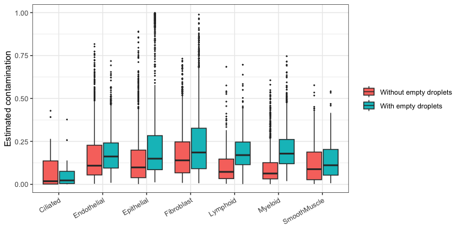
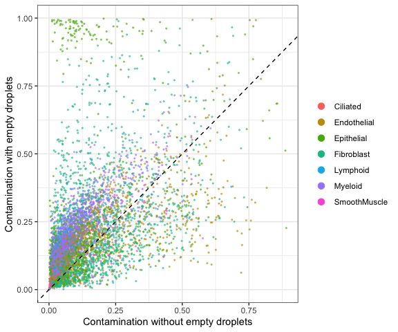
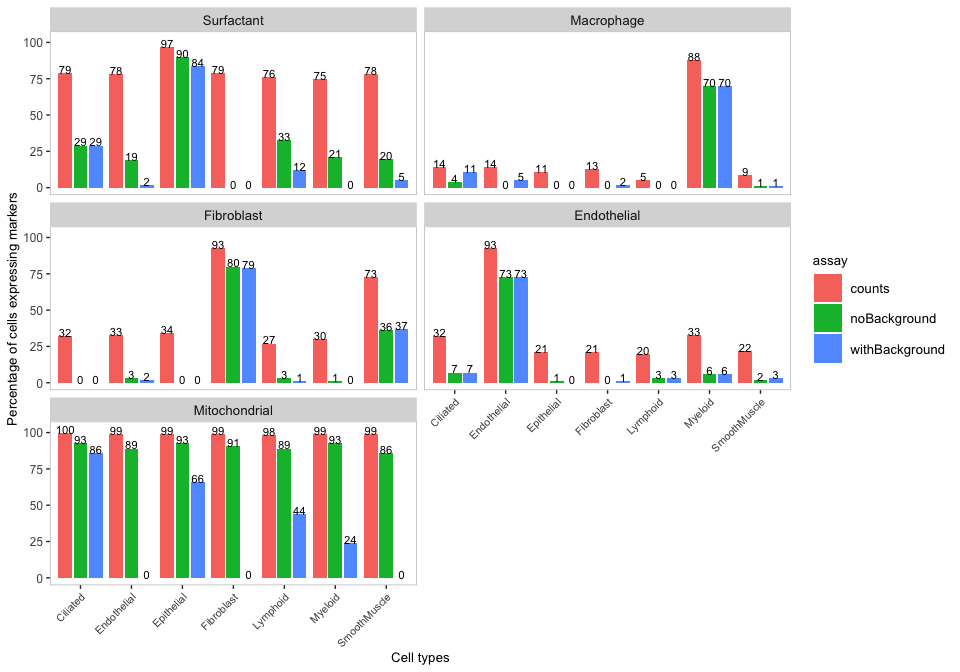

<!-- This is the source of decontX_background.Rmd. Edit this file, not
the .Rmd, then knit it from the package root with
make knit-article FILTER=decontX_background, which runs the code and
writes the .Rmd and its figures. Without that target, knit it in R from
vignettes/articles/, so the figures land next to the .Rmd:
knitr::knit("decontX_background.Rmd.orig", "decontX_background.Rmd") -->


*Computed with decontX 1.11.40 on 2026-11-25.
The code below downloads about 55 MB from GEO, a public database of
gene expression data, and takes a few minutes to run.*

# Why give DecontX the empty droplets?

In droplet-based single-cell data, such as data from 10x Genomics, each
cell is captured in a tiny droplet, and every droplet has its own
barcode. Sequencing counts how many RNA molecules of each gene are in
each droplet. Most droplets hold no cell. These *empty droplets* still
hold some RNA, because the liquid the cells float in contains free RNA,
called *ambient RNA*. Ambient RNA also gets into the droplets that hold
a cell, and adds counts of genes that the cell doesn't make. That is the
*contamination* that DecontX estimates and removes.

DecontX can work without the empty droplets. It first groups similar
cells into *clusters*, which roughly match cell types. Then, in each
cell, it treats counts of genes that belong to the other clusters as
contamination. This works well when most cells are fairly clean, so that
the genes typical of each cell type (its *markers*) stand out. It works
less well when:

- every cluster is heavily contaminated, so the other clusters don't
  show clearly what the contamination looks like, or
- much of the ambient RNA comes from material that isn't in any
  cluster, such as cells that broke apart while the tissue was
  processed.

The empty droplets hold the ambient RNA itself. When you give them to
DecontX with the `background` argument, it learns what the contamination
looks like from them, instead of from the other clusters.

Single-nucleus RNA-seq sequences the nuclei of cells instead of whole
cells. It is often heavily contaminated, because getting the nuclei out
of the tissue breaks the cells open and releases their RNA. This article
runs DecontX with and without the empty droplets on one lung sample from
a study of COVID-19, and compares the results. The
[DecontX vignette](decontX_RNA.html)
covers the basics, the plotting functions, and answers to common
questions (FAQ).

Besides decontX, the code uses these R packages:

- DropletUtils, to read the data and to find the droplets that hold a
  nucleus;
- BiocFileCache, to download the data and keep a copy, so that it is
  downloaded only once;
- SingleCellExperiment, which stores single-cell data;
- R.utils, to unzip the files, and ggplot2, to make plots.

The first three come from Bioconductor and the last two from CRAN.
`BiocManager::install()` installs both kinds.


``` r
library(decontX)
library(DropletUtils)
library(BiocFileCache)
library(SingleCellExperiment)
library(ggplot2)
```

# The data

The data come from Delorey et al. (2021), who studied tissue from people
who died of COVID-19. Among other data, they sequenced nuclei from lung
tissue with 10x Genomics. For each sample, the GEO series
[GSE171668](https://www.ncbi.nlm.nih.gov/geo/query/acc.cgi?acc=GSE171668)
has the *raw matrix*, with the counts of every gene in every droplet,
including the empty droplets. (The more common *filtered* matrix holds
only the droplets with a cell or nucleus, so it has no empty droplets.)

We use one lung sample, 02-P005175-S053-R01. The file is compressed. The
code downloads it once, keeps it in a cache folder, and unzips a copy
into a temporary folder:


``` r
# BiocFileCache keeps downloaded files, so later runs reuse them
bfc <- BiocFileCache(ask = FALSE)
geo <- "https://ftp.ncbi.nlm.nih.gov/geo/samples/"
rawUrl <- paste0(
  geo, "GSM5229nnn/GSM5229973/suppl/",
  "GSM5229973_02-P005175-S053-R01_raw_feature_bc_matrix.h5.gz"
)
# Download the file, or find it in the cache, and unzip a copy
rawH5 <- R.utils::gunzip(
  bfcrpath(bfc, rawUrl),
  destname = tempfile(fileext = ".h5"),
  remove = FALSE
)

# Read the counts: one row per gene, one column per droplet
raw <- read10xCounts(rawH5, col.names = TRUE, type = "HDF5")
# Store the counts as a sparse matrix, which saves memory because most
# counts are 0
counts(raw) <- as(counts(raw), "dgCMatrix")
# Drop the droplets with no counts at all
raw <- raw[, colSums(counts(raw)) > 0]
# The number of genes and of droplets
dim(raw)
#> [1]  33567 873511
```

Each gene name starts with the name of the reference genome that the
reads were matched to (`GRCh38premrna_`), so we remove it. A few gene
names appear twice; `make.unique()` adds a number to the repeats, so
every name is different:


``` r
rownames(raw) <- make.unique(sub("^GRCh38premrna_", "", rowData(raw)$Symbol))
```

# Finding the droplets with a nucleus

Next, we decide which droplets hold a nucleus. `emptyDropsCellRanger()`
does this the same way as CellRanger, the software from 10x Genomics. It
compares each droplet with the empty droplets and gives it a *false
discovery rate* (FDR). A low FDR means the droplet is very unlikely to
be empty, so we take the droplets with an FDR of 0.01 or less as nuclei.
The method uses random numbers, so we first set a *seed*, which makes it
give the same result every time:


``` r
set.seed(2021)
calls <- emptyDropsCellRanger(counts(raw))
# TRUE for the droplets that hold a nucleus
isNucleus <- !is.na(calls$FDR) & calls$FDR <= 0.01
# The number of nuclei
sum(isNucleus)
#> [1] 9258
```

All the other droplets are empty droplets. We give them to DecontX as
the background. `summary()` shows how many counts they hold:


``` r
empty <- raw[, !isNucleus]
summary(colSums(counts(empty)))
#>    Min. 1st Qu.  Median    Mean 3rd Qu.    Max. 
#>    1.00    1.00    1.00   15.38    2.00 1623.00
```

Most hold only a few counts, but there are hundreds of thousands of them,
so together they show the ambient RNA well.

Some of the nuclei are damaged, and quality control (QC) removes them.
Mitochondria are outside the nucleus, so a nucleus should hold few
mitochondrial RNAs (from the genes whose names start with `MT-`). A
nucleus with many of them probably still has part of the rest of the
cell attached, or is mostly ambient RNA. We keep the nuclei in which less
than 5% of the counts are mitochondrial:


``` r
nuclei <- raw[, isNucleus]
# TRUE for the mitochondrial genes
isMito <- grepl("^MT-", rownames(nuclei))
# The total count of each nucleus, and its percentage of mitochondrial
# counts
total <- colSums(counts(nuclei))
mitoPercent <- colSums(counts(nuclei)[isMito, ]) / total * 100
quantile(mitoPercent, c(0.5, 0.75, 0.9))
#>       50%       75%       90% 
#>  3.222344  7.279177 13.993977
nuclei <- nuclei[, mitoPercent < 5]
# The number of nuclei kept, and their median total count
ncol(nuclei)
#> [1] 5931
median(colSums(counts(nuclei)))
#> [1] 1216
```

The nuclei that fail QC are now in neither `nuclei` nor `empty`: they
aren't nuclei we want to clean, and they aren't empty droplets either.

# DecontX with and without the empty droplets

First, we run DecontX without the empty droplets. It groups the nuclei
into clusters, then estimates how much of each nucleus's counts is
contamination. `table()` shows how many nuclei are in each cluster:


``` r
noBackground <- decontX(nuclei)
table(noBackground$decontX_clusters)
#> 
#>    1    2    3    4    5    6    7 
#> 1590 1164 1721  266 1010   28  152
```

Then we run it again with the empty droplets, given as `background`. We
also give it the clusters from the first run, with `z`, so that both
runs use the same clusters and the empty droplets are the only
difference:


``` r
withBackground <- decontX(
  nuclei,
  z = noBackground$decontX_clusters,
  background = empty
)
```

## Naming the clusters

DecontX numbers the clusters. To compare the two runs by cell type, we
give the clusters names. Each cell type in the lung has marker genes,
which it makes and the other cell types don't. For each cluster, we
measure how much it expresses each cell type's markers, and name it
after the cell type whose markers score highest.

First, we *normalize* the counts with `normalizeRnaCounts.se()` from
the scrapper package, which decontX also uses. It scales each nucleus's
counts by its total, so that a nucleus doesn't score higher just because
it has more counts, and takes the log. The result is stored in `nuclei`
as a new assay, `logcounts`. Then, for each cluster, we average the
markers of each cell type. Last, `scale()` puts the scores of the
different cell types on the same scale:


``` r
# Marker genes of the main cell types in the lung
cellTypeMarkers <- list(
  Epithelial = c("SFTPC", "SFTPB", "NAPSA", "LAMP3", "AGER"),
  Ciliated = c("FOXJ1", "CAPS", "TPPP3"),
  Myeloid = c("MARCO", "CD163", "C1QA", "MRC1"),
  Lymphoid = c("CD3E", "CD2", "NKG7", "MS4A1"),
  Fibroblast = c("COL1A2", "DCN", "LUM"),
  Endothelial = c("PECAM1", "VWF", "CLDN5"),
  SmoothMuscle = c("ACTA2", "MYH11", "TAGLN")
)
# The cluster of each nucleus, from the first run
z <- noBackground$decontX_clusters
# Normalize the counts, adding the logcounts assay
nuclei <- scrapper::normalizeRnaCounts.se(nuclei)
# For each cell type, the mean of its markers, averaged over the nuclei
# of each cluster
score <- sapply(cellTypeMarkers, function(genes) {
  markerMeans <- colMeans(as.matrix(logcounts(nuclei)[genes, ]))
  tapply(markerMeans, z, mean)
})
# Put each cell type's scores on the same scale
score <- scale(score)
round(score, 1)
#>   Epithelial Ciliated Myeloid Lymphoid Fibroblast Endothelial SmoothMuscle
#> 1       -0.4     -0.4    -0.4     -0.4        2.2        -0.4         -0.2
#> 2       -0.3     -0.4    -0.3     -0.3       -0.4         2.3         -0.4
#> 3       -0.4     -0.4     2.3     -0.4       -0.5        -0.3         -0.4
#> 4        0.0     -0.3    -0.4      2.3       -0.4        -0.4         -0.4
#> 5        2.2     -0.4    -0.4     -0.4       -0.5        -0.5         -0.5
#> 6       -0.7      2.3    -0.3     -0.5       -0.6        -0.4         -0.4
#> 7       -0.4     -0.4    -0.4     -0.4        0.2        -0.4          2.3
#> attr(,"scaled:center")
#>   Epithelial     Ciliated      Myeloid     Lymphoid   Fibroblast  Endothelial 
#>   0.55833578   0.09075791   0.26640625   0.02583742   0.51829497   0.31331862 
#> SmoothMuscle 
#>   0.20906439 
#> attr(,"scaled:scale")
#>   Epithelial     Ciliated      Myeloid     Lymphoid   Fibroblast  Endothelial 
#>   0.39179953   0.19114811   0.41394707   0.05668636   0.58237322   0.43783648 
#> SmoothMuscle 
#>   0.35666977
# Name each cluster after the cell type with the highest score
clusterType <- setNames(colnames(score)[apply(score, 1, which.max)],
                        rownames(score))
clusterType
#>              1              2              3              4              5 
#>   "Fibroblast"  "Endothelial"      "Myeloid"     "Lymphoid"   "Epithelial" 
#>              6              7 
#>     "Ciliated" "SmoothMuscle"
# The cell type of each nucleus
nuclei$cellType <- unname(clusterType[as.character(z)])
```

In the table of scores, each row is a cluster and each column a cell
type. Each cluster has one score clearly higher than the others, so the
names are clear. With other data, check this table: if two cell types
score about the same for a cluster, look at more markers before you name
it.


# What changes with the empty droplets

## The amount of contamination

DecontX estimates the contamination of each nucleus as a number between
0 (none of its counts) and 1 (all of them). We put both runs' estimates
in one table and summarize them:


``` r
estimates <- data.frame(
  cellType = nuclei$cellType,
  noBackground = noBackground$decontX_contamination,
  withBackground = withBackground$decontX_contamination
)
summary(estimates[, c("noBackground", "withBackground")])
#>   noBackground       withBackground    
#>  Min.   :0.0004234   Min.   :0.000616  
#>  1st Qu.:0.0441446   1st Qu.:0.099124  
#>  Median :0.0958913   Median :0.169006  
#>  Mean   :0.1446768   Mean   :0.213485  
#>  3rd Qu.:0.1936822   3rd Qu.:0.269513  
#>  Max.   :0.8904357   Max.   :0.998077
```

The box plots show the estimates in each cell type. Each box spans the
middle half of the nuclei, and the line inside it is the median:


``` r
# Stack the two runs into one table, with a column that says which run
long <- data.frame(
  cellType = rep(estimates$cellType, 2),
  run = factor(
    rep(c("Without empty droplets", "With empty droplets"),
        each = nrow(estimates)),
    levels = c("Without empty droplets", "With empty droplets")
  ),
  contamination = c(estimates$noBackground, estimates$withBackground)
)
ggplot(long, aes(cellType, contamination, fill = run)) +
  geom_boxplot(outlier.size = 0.3) +
  labs(x = NULL, y = "Estimated contamination", fill = NULL) +
  theme_bw() +
  theme(axis.text.x = element_text(angle = 30, hjust = 1))
```



In the next plot, each point is a nucleus. Points above the dashed line
got a higher estimate with the empty droplets than without them. `cor()`
gives the correlation of the two runs' estimates: 1 would mean that they
rise and fall together perfectly, and 0 that they are unrelated.


``` r
ggplot(estimates, aes(noBackground, withBackground, color = cellType)) +
  geom_point(size = 0.4, alpha = 0.5) +
  geom_abline(linetype = "dashed") +
  guides(color = guide_legend(override.aes = list(size = 3, alpha = 1))) +
  labs(
    x = "Contamination without empty droplets",
    y = "Contamination with empty droplets",
    color = NULL
  ) +
  theme_bw()
```



``` r
cor(estimates$noBackground, estimates$withBackground)
#> [1] 0.48257
```


With the empty droplets, DecontX finds more contamination in most cell
types, and the two runs agree only loosely on which nuclei are the most
contaminated. One group of nuclei, mostly epithelial, comes out as
almost all contamination with the empty droplets: their counts look like
the empty droplets'. They may be damaged nuclei, or droplets that hold
mostly debris. Look at nuclei like these closely before you analyze them
further.

## What each run removes

The two runs also remove different genes. For each run, we add up how
much it removed of each gene, over all nuclei, and turn the totals into
shares that sum to 1. We do the same for the counts in the empty
droplets. The first table compares these three sets of shares with
correlations (taken on their square roots, so that a few very common
genes don't decide the result). The second table lists the ten genes
with the largest share in each:


``` r
# Each gene's share of all the counts that a run removed
removedShare <- function(decontaminated) {
  removed <- rowSums(counts(nuclei)) - rowSums(decontaminated)
  removed[removed < 0] <- 0
  removed / sum(removed)
}
profiles <- data.frame(
  emptyDroplets = rowSums(counts(empty)) / sum(counts(empty)),
  noBackground = removedShare(decontXcounts(noBackground)),
  withBackground = removedShare(decontXcounts(withBackground))
)
round(cor(sqrt(profiles)), 2)
#>                emptyDroplets noBackground withBackground
#> emptyDroplets           1.00         0.88           1.00
#> noBackground            0.88         1.00           0.88
#> withBackground          1.00         0.88           1.00

# The ten genes with the largest shares, with their shares in percent
topGenes <- function(share) {
  top <- head(sort(share, decreasing = TRUE), 10)
  paste0(names(top), " (", round(top * 100, 1), "%)")
}
data.frame(lapply(profiles, function(p) topGenes(setNames(p, rownames(nuclei)))))
#>      emptyDroplets    noBackground  withBackground
#> 1    MT-ND3 (2.8%)   MALAT1 (4.8%) RASGEF1B (2.5%)
#> 2  RASGEF1B (2.7%) RASGEF1B (0.7%)   MT-ND3 (2.1%)
#> 3      MT-CO2 (2%)    NEAT1 (0.6%)   MT-CO2 (1.6%)
#> 4    MT-ND2 (1.9%)   MT-ND3 (0.4%)   INO80D (1.4%)
#> 5   MT-ATP6 (1.5%)   INO80D (0.4%)   MT-ND2 (1.4%)
#> 6    INO80D (1.5%)   MT-CO2 (0.3%)   MALAT1 (1.2%)
#> 7    MALAT1 (1.4%)   MT-ND2 (0.3%)  MT-ATP6 (1.1%)
#> 8    MT-CO1 (1.2%)    SFTPB (0.3%)     MT-CO1 (1%)
#> 9      MT-CO3 (1%)      FTL (0.3%)      FTL (0.9%)
#> 10  SLC26A3 (0.9%)   MT-CO1 (0.2%)  SLC26A3 (0.8%)
```

With the empty droplets, what DecontX removes closely matches the empty
droplets. Their RNA is led by mitochondrial genes, which likely come from
the rest of the cell, stripped away when the nuclei were isolated.
Without the empty droplets, DecontX removes MALAT1 most, and few
mitochondrial RNAs: these are in every cluster, so comparing clusters
can't show that they are contamination.

## Markers in the wrong cell types

A good check is to look for marker genes in the cell types that
shouldn't have them, since any counts there are contamination. We add
both runs' decontaminated counts to the `nuclei` object, as extra
*assays* (tables of counts). `plotDecontXMarkerPercentage()` then shows,
for each cell type, the percentage of nuclei in which each set of
markers is found, in the original counts and after each run:


``` r
assay(nuclei, "noBackground") <- decontXcounts(noBackground)
assay(nuclei, "withBackground") <- decontXcounts(withBackground)

# Sets of markers to look for
markers <- list(
  Surfactant = c("SFTPC", "SFTPB"),
  Macrophage = c("MARCO", "CD163"),
  Fibroblast = c("COL1A2", "DCN"),
  Endothelial = c("PECAM1", "VWF"),
  Mitochondrial = c("MT-CO1", "MT-ND3")
)
# The clusters of each cell type
groupClusters <- split(names(clusterType), clusterType)
plotDecontXMarkerPercentage(
  nuclei,
  markers = markers,
  groupClusters = groupClusters,
  assayName = c("counts", "noBackground", "withBackground"),
  z = z
)
```



Before decontamination, the surfactant genes, which only one kind of
lung cell makes (the alveolar epithelial cells), are found in three
quarters or more of the nuclei of every cell type. Both runs remove most
of them from the other cell types, but the run with the empty droplets
removes more. It also removes the mitochondrial RNAs from most nuclei,
while the run without them leaves them in nearly all nuclei. In both
runs, the markers of fibroblasts, endothelial cells and macrophages drop
to a few percent outside their own cell types.

# Summary

- Give DecontX the empty droplets when you have them and the
  contamination is high. This is common in single-nucleus data, and in
  tissue that is hard to break up into single cells. Here the empty
  droplets changed which nuclei DecontX found contaminated, and which
  genes it removed.
- Leave out of the background every droplet you called as a cell or
  nucleus, including the ones that failed QC.
- With several samples, give each sample its own empty droplets, with
  the `bgBatch` argument; see the [DecontX vignette](decontX_RNA.html).

# Reference

Delorey TM, Ziegler CGK, Heimberg G, et al. COVID-19 tissue atlases reveal
SARS-CoV-2 pathology and cellular targets. *Nature* 595, 107–113 (2021).
<https://doi.org/10.1038/s41586-021-03570-8>

# Session information


``` r
sessionInfo()
#> R version 4.6.1 (2026-06-24)
#> Platform: aarch64-apple-darwin23
#> Running under: macOS Sequoia 15.6
#> 
#> Matrix products: default
#> BLAS:   /Library/Frameworks/R.framework/Versions/4.6/Resources/lib/libRblas.0.dylib 
#> LAPACK: /Library/Frameworks/R.framework/Versions/4.6/Resources/lib/libRlapack.dylib;  LAPACK version 3.12.1
#> 
#> locale:
#> [1] en_US.UTF-8/en_US.UTF-8/en_US.UTF-8/C/en_US.UTF-8/en_US.UTF-8
#> 
#> time zone: America/New_York
#> tzcode source: internal
#> 
#> attached base packages:
#> [1] stats4    stats     graphics  grDevices utils     datasets  methods  
#> [8] base     
#> 
#> other attached packages:
#>  [1] ggplot2_4.0.3               BiocFileCache_3.3.0        
#>  [3] dbplyr_2.6.0                DropletUtils_1.32.0        
#>  [5] SingleCellExperiment_1.35.2 SummarizedExperiment_1.43.0
#>  [7] Biobase_2.73.2              GenomicRanges_1.65.4       
#>  [9] Seqinfo_1.3.2               IRanges_2.47.5             
#> [11] S4Vectors_0.51.10           BiocGenerics_0.59.12       
#> [13] generics_0.1.4              MatrixGenerics_1.25.0      
#> [15] matrixStats_1.5.0           decontX_1.11.40            
#> 
#> loaded via a namespace (and not attached):
#>  [1] DBI_1.3.0                 gridExtra_2.3.1          
#>  [3] httr2_1.3.0               inline_0.3.21            
#>  [5] rlang_1.3.0               magrittr_2.0.5           
#>  [7] otel_0.2.0                compiler_4.6.1           
#>  [9] RSQLite_3.53.3            DelayedMatrixStats_1.34.0
#> [11] loo_2.10.1                vctrs_0.7.3              
#> [13] combinat_0.0-9            pkgconfig_2.0.3          
#> [15] fastmap_1.2.0             XVector_0.53.0           
#> [17] labeling_0.4.3            scuttle_1.23.2           
#> [19] purrr_1.2.2               bit_4.6.0                
#> [21] xfun_0.62                 cachem_1.1.0             
#> [23] beachmat_2.29.3           jsonlite_2.0.0           
#> [25] blob_1.3.0                rhdf5filters_1.25.5      
#> [27] DelayedArray_0.39.8       Rhdf5lib_2.1.0           
#> [29] BiocParallel_1.47.0       parallel_4.6.1           
#> [31] R6_2.6.1                  RColorBrewer_1.1-3       
#> [33] StanHeaders_2.39.1        MCMCprecision_0.4.2      
#> [35] limma_3.99.3              parallelly_1.50.0        
#> [37] Rcpp_1.1.2                rstan_2.32.7             
#> [39] knitr_1.52                future.apply_1.21.0      
#> [41] R.utils_2.13.0            Matrix_1.7-6             
#> [43] tidyselect_1.2.1          abind_1.4-8              
#> [45] codetools_0.2-20          curl_8.1.0               
#> [47] listenv_1.1.0             pkgbuild_1.4.8           
#> [49] lattice_0.23-1            tibble_3.3.1             
#> [51] withr_3.0.3               S7_0.2.2                 
#> [53] evaluate_1.0.5            future_1.80.0            
#> [55] RcppParallel_6.2.1        filelock_1.0.3           
#> [57] pillar_1.11.1             dbscan_1.2.7             
#> [59] sp_2.2-4                  scrapper_1.7.9           
#> [61] rstantools_2.7.1          sparseMatrixStats_1.24.0 
#> [63] scales_1.4.0              globals_0.20.0           
#> [65] glue_1.8.1                tools_4.6.1              
#> [67] BiocNeighbors_2.7.3       locfit_1.5-9.12          
#> [69] dotCall64_1.2             rhdf5_2.57.20            
#> [71] grid_4.6.1                QuickJSR_1.11.0          
#> [73] edgeR_4.99.10             HDF5Array_1.41.3         
#> [75] cli_3.6.6                 spam_2.11-4              
#> [77] S4Arrays_1.13.2           dplyr_1.2.1              
#> [79] V8_8.2.0                  gtable_0.3.6             
#> [81] R.methodsS3_1.8.2         digest_0.6.39            
#> [83] progressr_1.1.0           SparseArray_1.13.4       
#> [85] dqrng_0.4.1               SeuratObject_5.4.0       
#> [87] farver_2.1.2              memoise_2.0.1            
#> [89] R.oo_1.27.1               lifecycle_1.0.5          
#> [91] h5mread_1.5.3             statmod_1.5.2            
#> [93] bit64_4.8.6
```
