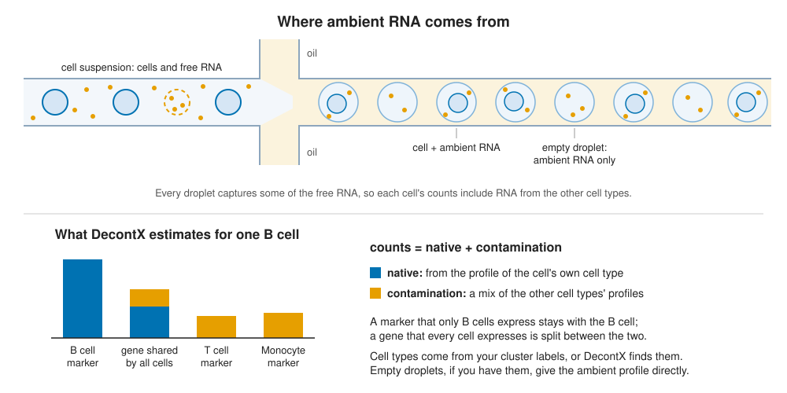
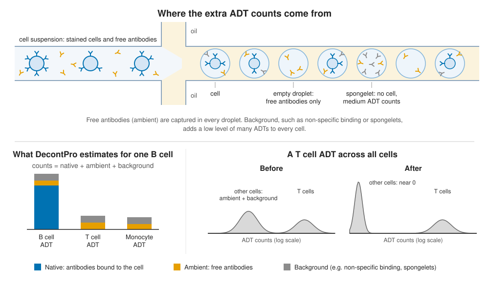

```{r setup, include=FALSE}
knitr::opts_chunk$set(
  collapse = TRUE,
  comment = "#>",
  dev = "png"
)
```

# Introduction

In droplet-based single-cell assays, each droplet should capture one cell.
But not every count in a droplet comes from its cell. Two kinds of
contamination add counts that aren't the cell's own:

- **Ambient contamination.** The cell suspension holds free material, such
  as RNA from cells that broke open, or free antibody-derived tags (ADTs),
  and some of it is captured in every droplet. Its profile is a mix of all
  the cells in the sample, so it adds counts of genes or proteins that the
  cell doesn't express: for example, T cell markers in a B cell.
- **Background contamination.** In protein (ADT) data, a low,
  non-specific level of counts for many ADTs, even in cell types that lack
  the protein. Possible sources include non-specific antibody binding and
  spongelets: droplets with no cell but a medium level of ADTs.

Contamination blurs the difference between cell types, and it can make a
cell look like it expresses markers of another cell type. The decontX
package estimates how much of each cell's counts comes from contamination
and removes it, with two methods.

# Which method to use

| Data | Method | Function | Workflow vignette |
|---|---|---|---|
| Single-cell RNA-seq counts | DecontX (Yang et al. 2020) | `decontX()` | [decontX (RNA)](decontX_RNA.html) |
| CITE-seq or other ADT counts | DecontPro (Yin et al. 2024) | `decontPro()` | [decontPro (Protein)](decontPro.html) |

- **DecontX** models each cell's counts as a mixture of its native
  expression and ambient RNA from the other cell populations. It needs the
  counts of the called cells. Cluster labels and the empty droplets are
  optional: without labels, DecontX finds clusters itself; without empty
  droplets, it estimates the ambient profile from the cells.
- **DecontPro** splits each ADT count into native, ambient and background
  parts. It needs the counts of the called cells and a cell type or
  cluster label for each cell. The empty droplets are optional.

For CITE-seq data, run DecontX on the RNA counts and DecontPro on the ADT
counts.

```{r figure_text, include=FALSE}
# Captions and alt text of the two figures below
cap_x <- paste(
  "DecontX. Free RNA in the cell suspension is captured in every droplet.",
  "DecontX splits each cell's counts into native counts, from its own cell",
  "type, and contamination, from the other cell types."
)
alt_x <- paste(
  "Top: in a microfluidic channel, the cell suspension, which holds free RNA",
  "from broken cells, is split by oil into a line of droplets; droplets with",
  "a cell and empty droplets both capture ambient RNA. Bottom: for one B",
  "cell, a B cell marker is all native, a gene shared by all cells is part",
  "native and part contamination, and T cell and monocyte markers are all",
  "contamination."
)
cap_pro <- paste(
  "DecontPro. Free antibodies (ambient) are captured in every droplet, and",
  "background adds a low level of many ADTs to every cell. DecontPro splits",
  "each cell's ADT counts into native, ambient and background parts."
)
alt_pro <- paste(
  "Top: in a microfluidic channel, stained cells and free antibodies are",
  "split into droplets: droplets with a cell, empty droplets with free",
  "antibodies only, and spongelets, with no cell but medium ADT counts.",
  "Bottom left: one B cell's ADT counts split into native, ambient and",
  "background parts. Bottom right: before decontamination, a T cell ADT has",
  "a peak in the other cells as well as in T cells; after, the other cells",
  "are near zero."
)
```

```{r model_x, echo=FALSE, out.width="100%", fig.cap=cap_x, fig.alt=alt_x}

```

```{r model_pro, echo=FALSE, out.width="100%", fig.cap=cap_pro, fig.alt=alt_pro}

```

# Installation

The decontX package can be installed from Bioconductor:

```{r install, eval=FALSE}
if (!requireNamespace("BiocManager", quietly = TRUE)) {
  install.packages("BiocManager")
}
BiocManager::install("decontX")
```

# A quick example

This example simulates RNA counts with a known amount of contamination,
then lets DecontX estimate it.

```{r load, message=FALSE}
library(decontX)
```

```{r quick_example, message=FALSE}
# Simulate counts for 300 cells, with known contamination
simulated <- simulateContamination()

# Estimate and remove the contamination
result <- decontX(simulated$observedCounts)

# The estimated contamination of the first cells, between 0 and 1
head(result$contamination)
```

The estimates follow the simulated contamination closely:

```{r quick_plot, fig.width=4.5, fig.height=4.5}
# Compare the estimates with the simulated contamination
plot(
  simulated$contamination,
  result$contamination,
  xlab = "Simulated contamination",
  ylab = "Estimated contamination"
)

# The line where the estimate equals the simulated value
abline(a = 0, b = 1)
```

The decontaminated counts are in `result$decontXcounts`.

# Next steps

The workflow vignettes run each method on real data, from importing the
counts to checking the results:

- [decontX (RNA)](decontX_RNA.html), `vignette("decontX_RNA", package =
  "decontX")`: DecontX on 10x PBMC data, with and without empty droplets,
  plots of the results, Seurat objects, several samples, and a FAQ.
- [decontPro (Protein)](decontPro.html), `vignette("decontPro", package =
  "decontX")`: DecontPro on CITE-seq cord blood ADT data, tuning its
  priors, and a FAQ.

The package website, <https://campbio.github.io/decontX/>, has these
vignettes and the help pages of every function. Its development version
also has two articles on larger, real data:
[Using empty droplets with DecontX](https://campbio.github.io/decontX/dev/articles/decontX_background.html),
on single-nucleus lung data, and
[DecontPro on 10x PBMC data with empty droplets](https://campbio.github.io/decontX/dev/articles/decontPro_pbmc10k.html).

# Citing decontX

Please cite the method you used:

- DecontX: Yang S, Corbett SE, Koga Y, Wang Z, Johnson WE, Yajima M,
  Campbell JD (2020). Decontamination of ambient RNA in single-cell RNA-seq
  with DecontX. *Genome Biology*, 21(1), 57.
  [doi:10.1186/s13059-020-1950-6](https://doi.org/10.1186/s13059-020-1950-6)
- DecontPro: Yin Y, Yajima M, Campbell JD (2024). Characterization and
  decontamination of background noise in droplet-based single-cell protein
  expression data with DecontPro. *Nucleic Acids Research*, 52(1), e4.
  [doi:10.1093/nar/gkad1032](https://doi.org/10.1093/nar/gkad1032)

`citation("decontX")` prints both references.

# Session information

```{r session_info}
sessionInfo()
```
